# shoken-webapp

## Description

shoken-webapp の DB スキーマ(テーブル一覧・外部キー・ER 図)

## Tables

| Name | Columns | Comment | Type |
| ---- | ------- | ------- | ---- |
| [public.users](public.users.md) | 6 | Google 認証のユーザー | BASE TABLE |
| [public.sessions](public.sessions.md) | 5 | ログインセッション | BASE TABLE |
| [public.dividends](public.dividends.md) | 14 | 配当・分配金の受取明細(CSV 取込) | BASE TABLE |
| [public.domestic_stocks](public.domestic_stocks.md) | 18 | 国内株式の売買明細(CSV 取込) | BASE TABLE |
| [public.mutualfunds](public.mutualfunds.md) | 17 | 投資信託の取引明細(CSV 取込) | BASE TABLE |
| [public.asset_balances](public.asset_balances.md) | 12 | 国内株式の保有残高(現在値) | BASE TABLE |
| [public.stock](public.stock.md) | 7 | 上場銘柄のマスタ(共有) | BASE TABLE |
| [public.dividend_per_share_cache](public.dividend_per_share_cache.md) | 9 | 1株配当のキャッシュ(共有) | BASE TABLE |
| [public.market_data_provider_rate_control](public.market_data_provider_rate_control.md) | 2 | 外部APIの呼び出し間隔(全インスタンス共有) | BASE TABLE |
| [public.security_prices](public.security_prices.md) | 5 | 銘柄ごとの共有株価 | BASE TABLE |
| [public.asset_balances_view](public.asset_balances_view.md) | 14 | 保有残高と共有株価の合成(読み取りビュー)。current_price / daily_change は共有の確定値を優先 | VIEW |
| [public.fund_balances](public.fund_balances.md) | 19 | 投資信託の保有残高(現在値) | BASE TABLE |
| [public.fund_codes](public.fund_codes.md) | 3 | ファンド名と投信協会コードの対応表(共有) | BASE TABLE |
| [public.fund_prices](public.fund_prices.md) | 7 | ファンドごとの共有基準価額 | BASE TABLE |
| [public.fund_balances_view](public.fund_balances_view.md) | 21 | 投信の保有残高と共有基準価額の合成(読み取りビュー)。price_source / nav_is_latest は出どころの判定 | VIEW |
| [public.csv_import_history](public.csv_import_history.md) | 3 | ユーザー・CSV種類ごとの最終取り込み成功時刻 | BASE TABLE |
| [public.login_events](public.login_events.md) | 9 | ログインの記録(端末IDはハッシュのみ。IPは保存しない) | BASE TABLE |

## Relations

```mermaid
erDiagram

"public.sessions" }o--|| "public.users" : "FOREIGN KEY (user_id) REFERENCES users(id) ON DELETE CASCADE"
"public.dividends" }o--|| "public.users" : "FOREIGN KEY (user_id) REFERENCES users(id) ON DELETE CASCADE"
"public.domestic_stocks" }o--|| "public.users" : "FOREIGN KEY (user_id) REFERENCES users(id) ON DELETE CASCADE"
"public.mutualfunds" }o--|| "public.users" : "FOREIGN KEY (user_id) REFERENCES users(id) ON DELETE CASCADE"
"public.asset_balances" }o--|| "public.users" : "FOREIGN KEY (user_id) REFERENCES users(id) ON DELETE CASCADE"
"public.fund_balances" }o--|| "public.users" : "FOREIGN KEY (user_id) REFERENCES users(id) ON DELETE CASCADE"
"public.csv_import_history" }o--|| "public.users" : "FOREIGN KEY (user_id) REFERENCES users(id) ON DELETE CASCADE"
"public.login_events" }o--|| "public.users" : "FOREIGN KEY (user_id) REFERENCES users(id) ON DELETE CASCADE"

"public.users" {
  uuid id
  varchar_255_ google_id
  varchar_255_ email
  varchar_255_ name
  timestamp_with_time_zone created_at
  timestamp_with_time_zone updated_at
}
"public.sessions" {
  uuid id
  uuid user_id FK
  timestamp_with_time_zone created_at
  timestamp_with_time_zone expires_at
  bytea token_hash
}
"public.dividends" {
  uuid id
  uuid user_id FK
  date settlement_date
  varchar_100_ product
  varchar_100_ account
  varchar_10_ security_code
  varchar_200_ security_name
  numeric unit_price
  numeric shares
  numeric dividends_before_tax
  numeric taxes
  numeric net_amount_received
  timestamp_with_time_zone created_at
  timestamp_with_time_zone updated_at
}
"public.domestic_stocks" {
  uuid id
  uuid user_id FK
  date trade_date
  date settlement_date
  varchar_10_ security_code
  varchar_200_ security_name
  varchar_100_ account
  numeric shares
  numeric asked_price
  numeric proceeds
  numeric purchase_price
  numeric realized_profit_and_loss
  numeric taxes
  numeric realized_profit_and_loss_after_tax
  text content_hash
  integer occurrence_index
  timestamp_with_time_zone created_at
  timestamp_with_time_zone updated_at
}
"public.mutualfunds" {
  uuid id
  uuid user_id FK
  date trade_date
  date settlement_date
  varchar_300_ fund_name
  varchar_100_ dividends
  varchar_100_ account
  numeric shares
  numeric exchange_rate
  numeric cancellation_unit_price_yen
  numeric cancellation_amount_yen
  numeric average_acquisition_price_yen
  numeric realized_profit_and_loss
  numeric taxes
  numeric realized_profit_and_loss_after_tax
  timestamp_with_time_zone created_at
  timestamp_with_time_zone updated_at
}
"public.asset_balances" {
  uuid id
  uuid user_id FK
  varchar_10_ security_code
  varchar_200_ security_name
  numeric shares
  numeric average_purchase_price
  numeric total_purchase_amount
  numeric csv_current_price
  numeric csv_daily_change
  timestamp_with_time_zone created_at
  timestamp_with_time_zone updated_at
  varchar_100_ account
}
"public.stock" {
  date date
  varchar_10_ code
  citext name
  varchar_50_ market_category
  varchar_100_ industry_category_33
  varchar_100_ industry_category_17
  varchar_50_ size_category
}
"public.dividend_per_share_cache" {
  varchar_10_ security_code
  numeric dividend_per_share
  varchar_20_ status
  timestamp_with_time_zone fetched_at
  varchar_50_ provider
  text error_message
  timestamp_with_time_zone stale_at
  timestamp_with_time_zone created_at
  timestamp_with_time_zone updated_at
}
"public.market_data_provider_rate_control" {
  varchar_50_ provider
  timestamp_with_time_zone next_available_at
}
"public.security_prices" {
  varchar_10_ security_code
  numeric current_price
  date price_as_of
  timestamp_with_time_zone updated_at
  numeric prev_close
}
"public.asset_balances_view" {
  uuid id
  uuid user_id
  varchar_10_ security_code
  varchar_200_ security_name
  numeric shares
  numeric average_purchase_price
  numeric total_purchase_amount
  numeric current_price
  numeric daily_change
  date price_as_of
  timestamp_with_time_zone created_at
  timestamp_with_time_zone updated_at
  numeric prev_close
  varchar_100_ account
}
"public.fund_balances" {
  uuid id
  uuid user_id FK
  varchar_200_ fund_name
  varchar_100_ account
  varchar_50_ dividends_course
  numeric shares
  numeric average_purchase_price
  numeric total_purchase_amount
  numeric base_price
  numeric base_price_day_change
  numeric base_price_month_change
  numeric market_value
  numeric profit_loss
  numeric profit_loss_rate
  numeric total_return
  date price_as_of
  timestamp_with_time_zone created_at
  timestamp_with_time_zone updated_at
  text normalized_fund_name
}
"public.fund_codes" {
  text normalized_name
  varchar_10_ association_fund_cd
  varchar_200_ fund_name
}
"public.fund_prices" {
  varchar_10_ association_fund_cd
  numeric nav
  numeric prev_day_change
  date price_as_of
  timestamp_with_time_zone updated_at
  text fetch_error
  timestamp_with_time_zone fetch_failed_at
}
"public.fund_balances_view" {
  uuid id
  uuid user_id
  varchar_200_ fund_name
  varchar_100_ account
  varchar_50_ dividends_course
  numeric shares
  numeric average_purchase_price
  numeric total_purchase_amount
  numeric base_price
  numeric base_price_day_change
  numeric base_price_month_change
  numeric market_value
  numeric profit_loss
  numeric profit_loss_rate
  numeric total_return
  date price_as_of
  timestamp_with_time_zone created_at
  timestamp_with_time_zone updated_at
  text price_source
  boolean nav_is_latest
  date expected_nav_date
}
"public.csv_import_history" {
  uuid user_id FK
  text kind
  timestamp_with_time_zone last_imported_at
}
"public.login_events" {
  uuid id
  uuid user_id FK
  timestamp_with_time_zone occurred_at
  text result
  bytea device_hash
  text country
  text region
  text browser
  text os
}
```

---

> Generated by [tbls](https://github.com/k1LoW/tbls)
