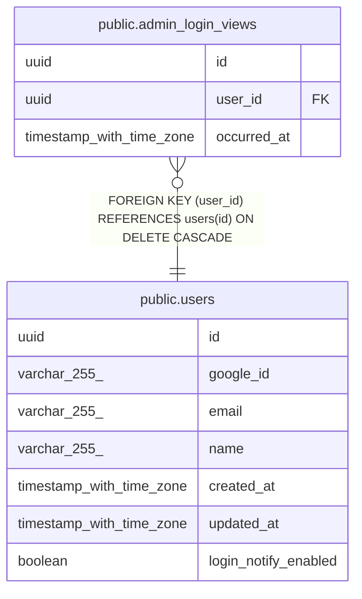

# public.admin_login_views

## Description

管理者によるログイン一覧の閲覧監査（閲覧者と日時のみ）

## Columns

| Name | Type | Default | Nullable | Children | Parents | Comment |
| ---- | ---- | ------- | -------- | -------- | ------- | ------- |
| id | uuid | gen_random_uuid() | false |  |  |  |
| user_id | uuid |  | false |  | [public.users](public.users.md) |  |
| occurred_at | timestamp with time zone | now() | false |  |  |  |

## Constraints

| Name | Type | Definition |
| ---- | ---- | ---------- |
| admin_login_views_user_id_fkey | FOREIGN KEY | FOREIGN KEY (user_id) REFERENCES users(id) ON DELETE CASCADE |
| admin_login_views_pkey | PRIMARY KEY | PRIMARY KEY (id) |

## Indexes

| Name | Definition |
| ---- | ---------- |
| admin_login_views_pkey | CREATE UNIQUE INDEX admin_login_views_pkey ON public.admin_login_views USING btree (id) |
| idx_admin_login_views_user_occurred | CREATE INDEX idx_admin_login_views_user_occurred ON public.admin_login_views USING btree (user_id, occurred_at DESC) |

## Relations

---

> Generated by [tbls](https://github.com/k1LoW/tbls)
