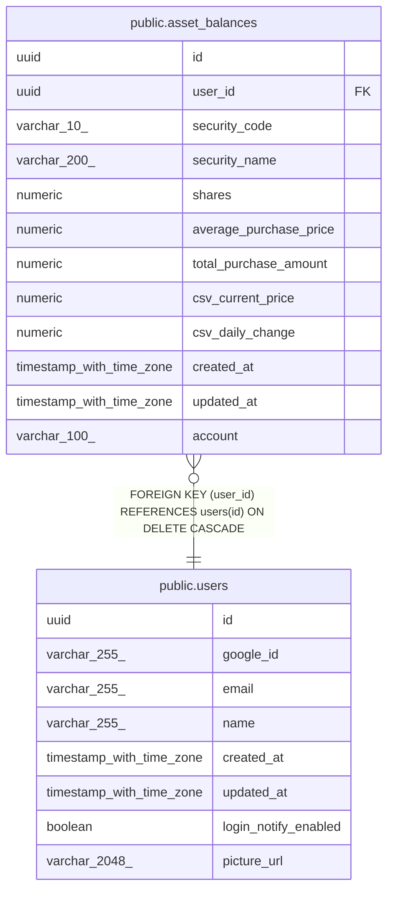

# public.asset_balances

## Description

国内株式の保有残高(現在値)

## Columns

| Name | Type | Default | Nullable | Children | Parents | Comment |
| ---- | ---- | ------- | -------- | -------- | ------- | ------- |
| id | uuid | gen_random_uuid() | false |  |  |  |
| user_id | uuid |  | false |  | [public.users](public.users.md) |  |
| security_code | varchar(10) |  | false |  |  |  |
| security_name | varchar(200) |  | false |  |  |  |
| shares | numeric |  | false |  |  |  |
| average_purchase_price | numeric |  | false |  |  |  |
| total_purchase_amount | numeric |  | false |  |  |  |
| csv_current_price | numeric | 0 | false |  |  | CSV 由来の現在値(共有の確定値があるときはそちらを使う) |
| csv_daily_change | numeric | 0 | false |  |  | CSV 由来の前日比 |
| created_at | timestamp with time zone | now() | false |  |  |  |
| updated_at | timestamp with time zone | now() | false |  |  |  |
| account | varchar(100) |  | true |  |  |  |

## Constraints

| Name | Type | Definition |
| ---- | ---- | ---------- |
| asset_balances_user_id_fkey | FOREIGN KEY | FOREIGN KEY (user_id) REFERENCES users(id) ON DELETE CASCADE |
| asset_balances_pkey | PRIMARY KEY | PRIMARY KEY (id) |

## Indexes

| Name | Definition |
| ---- | ---------- |
| asset_balances_pkey | CREATE UNIQUE INDEX asset_balances_pkey ON public.asset_balances USING btree (id) |
| idx_asset_balances_security_name_trgm | CREATE INDEX idx_asset_balances_security_name_trgm ON public.asset_balances USING gin (security_name gin_trgm_ops) |
| idx_asset_balances_user_security_name | CREATE INDEX idx_asset_balances_user_security_name ON public.asset_balances USING btree (user_id, security_name) |
| idx_asset_balances_user_security | CREATE UNIQUE INDEX idx_asset_balances_user_security ON public.asset_balances USING btree (user_id, security_code, account) NULLS NOT DISTINCT |

## Relations

---

> Generated by [tbls](https://github.com/k1LoW/tbls)
