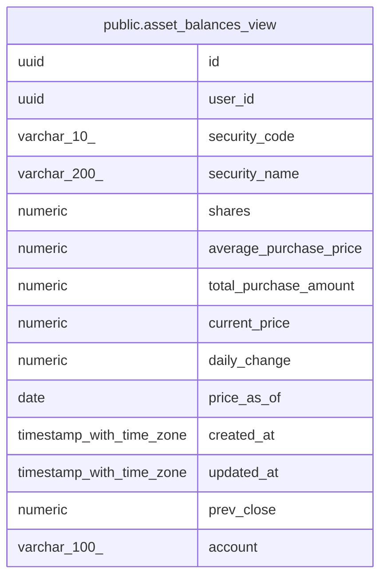

# public.asset_balances_view

## Description

保有残高と共有株価の合成(読み取りビュー)。current_price / daily_change は共有の確定値を優先

<details>
<summary><strong>Table Definition</strong></summary>

```sql
CREATE VIEW asset_balances_view AS (
 SELECT ab.id,
    ab.user_id,
    ab.security_code,
    ab.security_name,
    ab.shares,
    ab.average_purchase_price,
    ab.total_purchase_amount,
        CASE
            WHEN (sp.price_as_of IS NOT NULL) THEN sp.current_price
            ELSE ab.csv_current_price
        END AS current_price,
        CASE
            WHEN (sp.price_as_of IS NOT NULL) THEN COALESCE((sp.current_price - sp.prev_close), (0)::numeric)
            ELSE ab.csv_daily_change
        END AS daily_change,
    sp.price_as_of,
    ab.created_at,
    ab.updated_at,
    sp.prev_close,
    ab.account
   FROM (asset_balances ab
     LEFT JOIN security_prices sp ON (((sp.security_code)::text = (ab.security_code)::text)))
)
```

</details>

## Columns

| Name | Type | Default | Nullable | Children | Parents | Comment |
| ---- | ---- | ------- | -------- | -------- | ------- | ------- |
| id | uuid |  | true |  |  |  |
| user_id | uuid |  | true |  |  |  |
| security_code | varchar(10) |  | true |  |  |  |
| security_name | varchar(200) |  | true |  |  |  |
| shares | numeric |  | true |  |  |  |
| average_purchase_price | numeric |  | true |  |  |  |
| total_purchase_amount | numeric |  | true |  |  |  |
| current_price | numeric |  | true |  |  |  |
| daily_change | numeric |  | true |  |  |  |
| price_as_of | date |  | true |  |  |  |
| created_at | timestamp with time zone |  | true |  |  |  |
| updated_at | timestamp with time zone |  | true |  |  |  |
| prev_close | numeric |  | true |  |  |  |
| account | varchar(100) |  | true |  |  |  |

## Referenced Tables

| Name | Columns | Comment | Type |
| ---- | ------- | ------- | ---- |
| [public.asset_balances](public.asset_balances.md) | 12 | 国内株式の保有残高(現在値) | BASE TABLE |
| [public.security_prices](public.security_prices.md) | 5 | 銘柄ごとの共有株価 | BASE TABLE |

## Relations



---

> Generated by [tbls](https://github.com/k1LoW/tbls)
