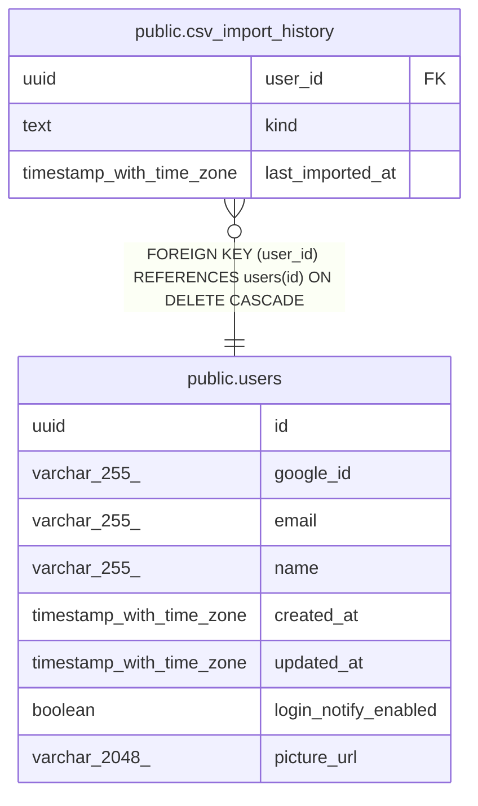

# public.csv_import_history

## Description

ユーザー・CSV種類ごとの最終取り込み成功時刻

## Columns

| Name | Type | Default | Nullable | Children | Parents | Comment |
| ---- | ---- | ------- | -------- | -------- | ------- | ------- |
| user_id | uuid |  | false |  | [public.users](public.users.md) |  |
| kind | text |  | false |  |  |  |
| last_imported_at | timestamp with time zone | now() | false |  |  |  |

## Constraints

| Name | Type | Definition |
| ---- | ---- | ---------- |
| csv_import_history_kind_check | CHECK | CHECK ((kind = ANY (ARRAY['assetbalance'::text, 'fundbalance'::text, 'dividend'::text, 'domesticstock'::text, 'mutualfund'::text]))) |
| csv_import_history_user_id_fkey | FOREIGN KEY | FOREIGN KEY (user_id) REFERENCES users(id) ON DELETE CASCADE |
| csv_import_history_pkey | PRIMARY KEY | PRIMARY KEY (user_id, kind) |

## Indexes

| Name | Definition |
| ---- | ---------- |
| csv_import_history_pkey | CREATE UNIQUE INDEX csv_import_history_pkey ON public.csv_import_history USING btree (user_id, kind) |

## Relations

---

> Generated by [tbls](https://github.com/k1LoW/tbls)
