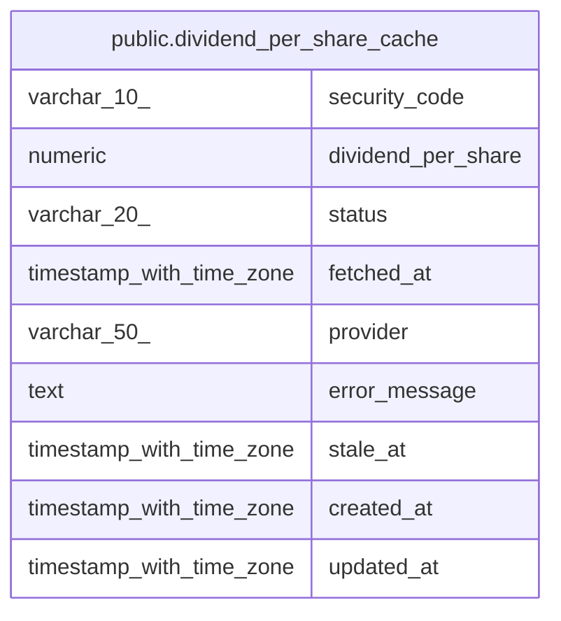

# public.dividend_per_share_cache

## Description

1株配当のキャッシュ(共有)

## Columns

| Name | Type | Default | Nullable | Children | Parents | Comment |
| ---- | ---- | ------- | -------- | -------- | ------- | ------- |
| security_code | varchar(10) |  | false |  |  |  |
| dividend_per_share | numeric |  | true |  |  |  |
| status | varchar(20) | 'pending'::character varying | false |  |  | 取得状態(ok / zero / error / pending) |
| fetched_at | timestamp with time zone |  | true |  |  |  |
| provider | varchar(50) | 'jquants'::character varying | false |  |  |  |
| error_message | text |  | true |  |  |  |
| stale_at | timestamp with time zone |  | true |  |  | TTL 期限。この時刻を過ぎると再取得対象 |
| created_at | timestamp with time zone | now() | false |  |  |  |
| updated_at | timestamp with time zone | now() | false |  |  |  |

## Constraints

| Name | Type | Definition |
| ---- | ---- | ---------- |
| dividend_per_share_cache_pkey | PRIMARY KEY | PRIMARY KEY (security_code) |

## Indexes

| Name | Definition |
| ---- | ---------- |
| dividend_per_share_cache_pkey | CREATE UNIQUE INDEX dividend_per_share_cache_pkey ON public.dividend_per_share_cache USING btree (security_code) |

## Relations

---

> Generated by [tbls](https://github.com/k1LoW/tbls)
