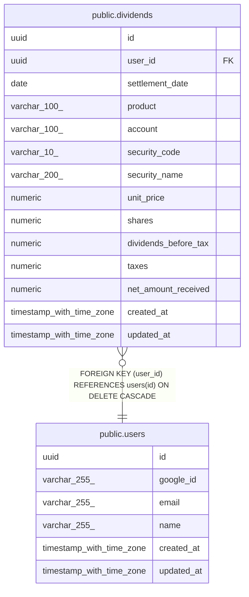

# public.dividends

## Description

配当・分配金の受取明細(CSV 取込)

## Columns

| Name | Type | Default | Nullable | Children | Parents | Comment |
| ---- | ---- | ------- | -------- | -------- | ------- | ------- |
| id | uuid | gen_random_uuid() | false |  |  |  |
| user_id | uuid |  | false |  | [public.users](public.users.md) |  |
| settlement_date | date |  | false |  |  |  |
| product | varchar(100) |  | false |  |  |  |
| account | varchar(100) |  | false |  |  |  |
| security_code | varchar(10) |  | false |  |  |  |
| security_name | varchar(200) |  | false |  |  |  |
| unit_price | numeric |  | false |  |  |  |
| shares | numeric |  | false |  |  |  |
| dividends_before_tax | numeric |  | false |  |  |  |
| taxes | numeric |  | false |  |  |  |
| net_amount_received | numeric |  | false |  |  |  |
| created_at | timestamp with time zone | now() | false |  |  |  |
| updated_at | timestamp with time zone | now() | false |  |  |  |

## Constraints

| Name | Type | Definition |
| ---- | ---- | ---------- |
| dividends_user_id_fkey | FOREIGN KEY | FOREIGN KEY (user_id) REFERENCES users(id) ON DELETE CASCADE |
| dividends_pkey | PRIMARY KEY | PRIMARY KEY (id) |

## Indexes

| Name | Definition |
| ---- | ---------- |
| dividends_pkey | CREATE UNIQUE INDEX dividends_pkey ON public.dividends USING btree (id) |
| idx_dividends_security_name_trgm | CREATE INDEX idx_dividends_security_name_trgm ON public.dividends USING gin (security_name gin_trgm_ops) |
| idx_dividends_unique | CREATE UNIQUE INDEX idx_dividends_unique ON public.dividends USING btree (user_id, settlement_date, security_code, security_name, shares, dividends_before_tax, product, account) |
| idx_dividends_user_account | CREATE INDEX idx_dividends_user_account ON public.dividends USING btree (user_id, account) |
| idx_dividends_user_product | CREATE INDEX idx_dividends_user_product ON public.dividends USING btree (user_id, product) |
| idx_dividends_user_security_code | CREATE INDEX idx_dividends_user_security_code ON public.dividends USING btree (user_id, security_code) |
| idx_dividends_user_security_name | CREATE INDEX idx_dividends_user_security_name ON public.dividends USING btree (user_id, security_name) |
| idx_dividends_user_settlement_date_id | CREATE INDEX idx_dividends_user_settlement_date_id ON public.dividends USING btree (user_id, settlement_date DESC, id DESC) |

## Relations

---

> Generated by [tbls](https://github.com/k1LoW/tbls)
