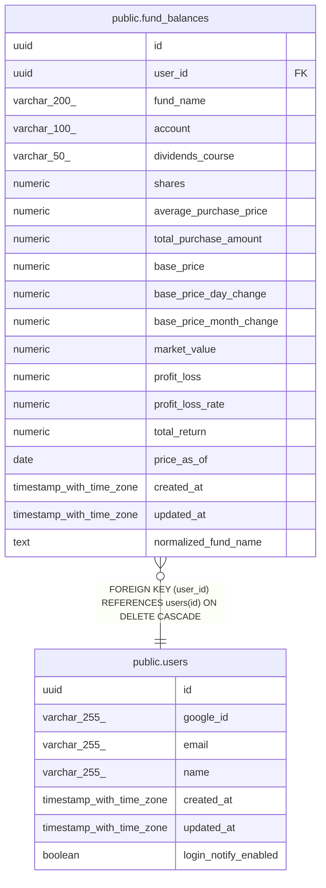

# public.fund_balances

## Description

投資信託の保有残高(現在値)

## Columns

| Name | Type | Default | Nullable | Extra Definition | Children | Parents | Comment |
| ---- | ---- | ------- | -------- | ---------------- | -------- | ------- | ------- |
| id | uuid | gen_random_uuid() | false |  |  |  |  |
| user_id | uuid |  | false |  |  | [public.users](public.users.md) |  |
| fund_name | varchar(200) |  | false |  |  |  |  |
| account | varchar(100) |  | false |  |  |  |  |
| dividends_course | varchar(50) |  | true |  |  |  |  |
| shares | numeric |  | false |  |  |  |  |
| average_purchase_price | numeric |  | false |  |  |  |  |
| total_purchase_amount | numeric |  | false |  |  |  |  |
| base_price | numeric |  | false |  |  |  | CSV 由来の基準価額 |
| base_price_day_change | numeric |  | true |  |  |  |  |
| base_price_month_change | numeric |  | true |  |  |  |  |
| market_value | numeric |  | false |  |  |  |  |
| profit_loss | numeric |  | false |  |  |  |  |
| profit_loss_rate | numeric |  | true |  |  |  |  |
| total_return | numeric |  | true |  |  |  |  |
| price_as_of | date |  | false |  |  |  | CSV の基準価額の基準日 |
| created_at | timestamp with time zone | now() | false |  |  |  |  |
| updated_at | timestamp with time zone | now() | false |  |  |  |  |
| normalized_fund_name | text |  | true | GENERATED ALWAYS AS fund_name_normalize((fund_name)::text) STORED |  |  | 照合用に正規化したファンド名 |

## Constraints

| Name | Type | Definition |
| ---- | ---- | ---------- |
| fund_balances_user_id_fkey | FOREIGN KEY | FOREIGN KEY (user_id) REFERENCES users(id) ON DELETE CASCADE |
| fund_balances_pkey | PRIMARY KEY | PRIMARY KEY (id) |

## Indexes

| Name | Definition |
| ---- | ---------- |
| fund_balances_pkey | CREATE UNIQUE INDEX fund_balances_pkey ON public.fund_balances USING btree (id) |
| idx_fund_balances_fund_name_trgm | CREATE INDEX idx_fund_balances_fund_name_trgm ON public.fund_balances USING gin (fund_name gin_trgm_ops) |
| idx_fund_balances_user_fund_name | CREATE INDEX idx_fund_balances_user_fund_name ON public.fund_balances USING btree (user_id, fund_name) |
| idx_fund_balances_user_account | CREATE INDEX idx_fund_balances_user_account ON public.fund_balances USING btree (user_id, account) |

## Relations

---

> Generated by [tbls](https://github.com/k1LoW/tbls)
