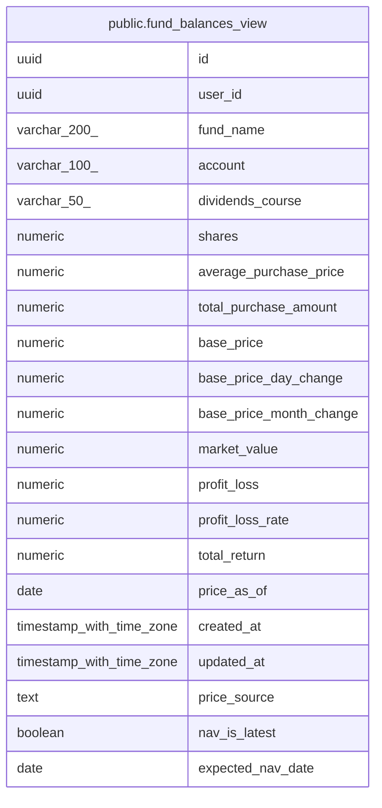

# public.fund_balances_view

## Description

投信の保有残高と共有基準価額の合成(読み取りビュー)。price_source / nav_is_latest は出どころの判定

<details>
<summary><strong>Table Definition</strong></summary>

```sql
CREATE VIEW fund_balances_view AS (
 WITH decided AS (
         SELECT fb.id,
            fb.user_id,
            fb.fund_name,
            fb.account,
            fb.dividends_course,
            fb.shares,
            fb.average_purchase_price,
            fb.total_purchase_amount,
            fb.base_price,
            fb.base_price_day_change,
            fb.base_price_month_change,
            fb.market_value,
            fb.profit_loss,
            fb.profit_loss_rate,
            fb.total_return,
            fb.price_as_of,
            fb.created_at,
            fb.updated_at,
            fp.nav AS shared_nav,
            fp.prev_day_change AS shared_day_change,
            fp.price_as_of AS shared_as_of,
            fund_expected_nav_date(now()) AS expected_nav_date,
                CASE
                    WHEN (fp.price_as_of >= fund_expected_nav_date(now())) THEN true
                    WHEN (fb.created_at >= ((fund_expected_nav_date(now()) + '23:00:00'::time without time zone) AT TIME ZONE 'Asia/Tokyo'::text)) THEN false
                    ELSE ((fp.price_as_of IS NOT NULL) AND (fp.price_as_of >= (fb.price_as_of - 3)))
                END AS use_shared
           FROM ((fund_balances fb
             LEFT JOIN fund_codes fc ON ((fc.normalized_name = fb.normalized_fund_name)))
             LEFT JOIN fund_prices fp ON (((fp.association_fund_cd)::text = (fc.association_fund_cd)::text)))
        )
 SELECT id,
    user_id,
    fund_name,
    account,
    dividends_course,
    shares,
    average_purchase_price,
    total_purchase_amount,
        CASE
            WHEN use_shared THEN shared_nav
            ELSE base_price
        END AS base_price,
        CASE
            WHEN use_shared THEN shared_day_change
            ELSE base_price_day_change
        END AS base_price_day_change,
    base_price_month_change,
        CASE
            WHEN use_shared THEN floor(((shares * shared_nav) / (10000)::numeric))
            ELSE market_value
        END AS market_value,
        CASE
            WHEN use_shared THEN (floor(((shares * shared_nav) / (10000)::numeric)) - total_purchase_amount)
            ELSE profit_loss
        END AS profit_loss,
        CASE
            WHEN use_shared THEN
            CASE
                WHEN (total_purchase_amount > (0)::numeric) THEN round((((floor(((shares * shared_nav) / (10000)::numeric)) - total_purchase_amount) / total_purchase_amount) * (100)::numeric), 4)
                ELSE NULL::numeric
            END
            ELSE profit_loss_rate
        END AS profit_loss_rate,
    total_return,
        CASE
            WHEN use_shared THEN shared_as_of
            ELSE price_as_of
        END AS price_as_of,
    created_at,
    updated_at,
        CASE
            WHEN use_shared THEN 'api'::text
            ELSE 'csv'::text
        END AS price_source,
        CASE
            WHEN use_shared THEN (shared_as_of >= expected_nav_date)
            ELSE (created_at >= ((expected_nav_date + '23:00:00'::time without time zone) AT TIME ZONE 'Asia/Tokyo'::text))
        END AS nav_is_latest,
    expected_nav_date
   FROM decided d
)
```

</details>

## Columns

| Name | Type | Default | Nullable | Children | Parents | Comment |
| ---- | ---- | ------- | -------- | -------- | ------- | ------- |
| id | uuid |  | true |  |  |  |
| user_id | uuid |  | true |  |  |  |
| fund_name | varchar(200) |  | true |  |  |  |
| account | varchar(100) |  | true |  |  |  |
| dividends_course | varchar(50) |  | true |  |  |  |
| shares | numeric |  | true |  |  |  |
| average_purchase_price | numeric |  | true |  |  |  |
| total_purchase_amount | numeric |  | true |  |  |  |
| base_price | numeric |  | true |  |  |  |
| base_price_day_change | numeric |  | true |  |  |  |
| base_price_month_change | numeric |  | true |  |  |  |
| market_value | numeric |  | true |  |  |  |
| profit_loss | numeric |  | true |  |  |  |
| profit_loss_rate | numeric |  | true |  |  |  |
| total_return | numeric |  | true |  |  |  |
| price_as_of | date |  | true |  |  |  |
| created_at | timestamp with time zone |  | true |  |  |  |
| updated_at | timestamp with time zone |  | true |  |  |  |
| price_source | text |  | true |  |  |  |
| nav_is_latest | boolean |  | true |  |  |  |
| expected_nav_date | date |  | true |  |  |  |

## Referenced Tables

| Name | Columns | Comment | Type |
| ---- | ------- | ------- | ---- |
| [public.fund_balances](public.fund_balances.md) | 19 | 投資信託の保有残高(現在値) | BASE TABLE |
| [public.fund_codes](public.fund_codes.md) | 3 | ファンド名と投信協会コードの対応表(共有) | BASE TABLE |
| [public.fund_prices](public.fund_prices.md) | 7 | ファンドごとの共有基準価額 | BASE TABLE |

## Relations



---

> Generated by [tbls](https://github.com/k1LoW/tbls)
