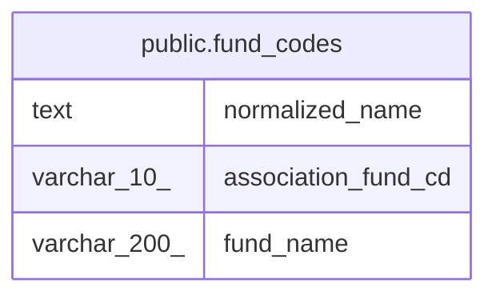

# public.fund_codes

## Description

ファンド名と投信協会コードの対応表(共有)

## Columns

| Name | Type | Default | Nullable | Children | Parents | Comment |
| ---- | ---- | ------- | -------- | -------- | ------- | ------- |
| normalized_name | text |  | false |  |  | 照合用に正規化したファンド名 |
| association_fund_cd | varchar(10) |  | false |  |  |  |
| fund_name | varchar(200) |  | false |  |  |  |

## Constraints

| Name | Type | Definition |
| ---- | ---- | ---------- |
| fund_codes_pkey | PRIMARY KEY | PRIMARY KEY (normalized_name) |

## Indexes

| Name | Definition |
| ---- | ---------- |
| fund_codes_pkey | CREATE UNIQUE INDEX fund_codes_pkey ON public.fund_codes USING btree (normalized_name) |

## Relations

---

> Generated by [tbls](https://github.com/k1LoW/tbls)
