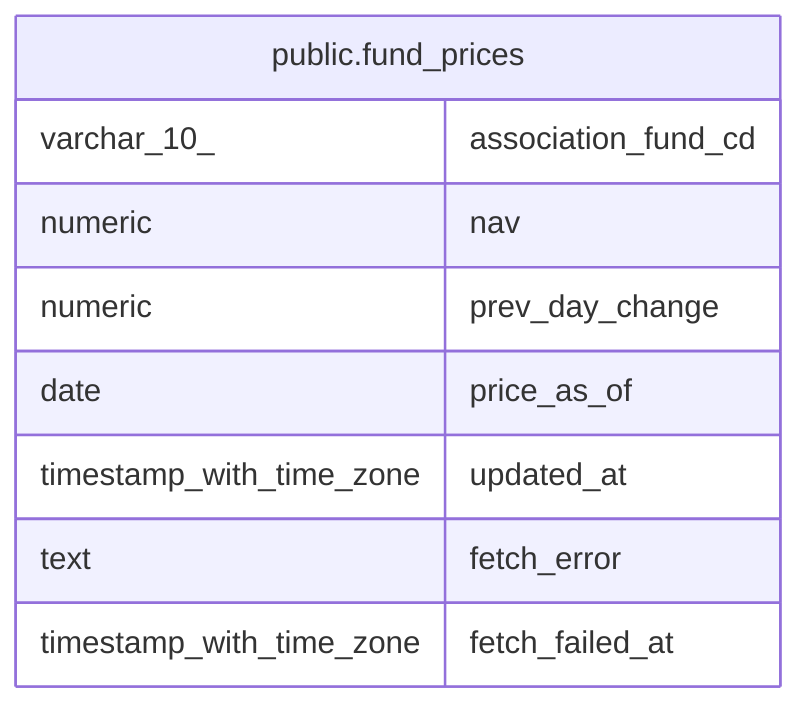

# public.fund_prices

## Description

ファンドごとの共有基準価額

## Columns

| Name | Type | Default | Nullable | Children | Parents | Comment |
| ---- | ---- | ------- | -------- | -------- | ------- | ------- |
| association_fund_cd | varchar(10) |  | false |  |  |  |
| nav | numeric |  | true |  |  | 共有の基準価額 |
| prev_day_change | numeric |  | true |  |  | 共有の基準価額の前日比 |
| price_as_of | date |  | true |  |  | 基準価額の基準日 |
| updated_at | timestamp with time zone | now() | false |  |  |  |
| fetch_error | text |  | true |  |  | 直近の基準価額取得の失敗理由 |
| fetch_failed_at | timestamp with time zone |  | true |  |  | 直近の基準価額取得の失敗時刻 |

## Constraints

| Name | Type | Definition |
| ---- | ---- | ---------- |
| fund_prices_pkey | PRIMARY KEY | PRIMARY KEY (association_fund_cd) |

## Indexes

| Name | Definition |
| ---- | ---------- |
| fund_prices_pkey | CREATE UNIQUE INDEX fund_prices_pkey ON public.fund_prices USING btree (association_fund_cd) |

## Relations

---

> Generated by [tbls](https://github.com/k1LoW/tbls)
