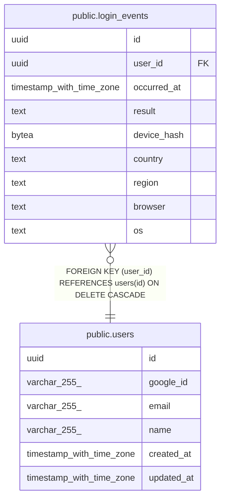

# public.login_events

## Description

ログインの記録(端末IDはハッシュのみ。IPは保存しない)

## Columns

| Name | Type | Default | Nullable | Children | Parents | Comment |
| ---- | ---- | ------- | -------- | -------- | ------- | ------- |
| id | uuid | gen_random_uuid() | false |  |  |  |
| user_id | uuid |  | false |  | [public.users](public.users.md) |  |
| occurred_at | timestamp with time zone | now() | false |  |  |  |
| result | text |  | false |  |  | 成功・新しい端末・場所の変化・失敗 |
| device_hash | bytea |  | false |  |  | 端末IDのSHA-256(平文は保存しない) |
| country | text |  | true |  |  | Cloudflare由来の国 |
| region | text |  | true |  |  | Cloudflare由来の都道府県相当 |
| browser | text |  | true |  |  |  |
| os | text |  | true |  |  |  |

## Constraints

| Name | Type | Definition |
| ---- | ---- | ---------- |
| login_events_result_check | CHECK | CHECK ((result = ANY (ARRAY['success'::text, 'new_device'::text, 'location_changed'::text, 'failure'::text]))) |
| login_events_user_id_fkey | FOREIGN KEY | FOREIGN KEY (user_id) REFERENCES users(id) ON DELETE CASCADE |
| login_events_pkey | PRIMARY KEY | PRIMARY KEY (id) |

## Indexes

| Name | Definition |
| ---- | ---------- |
| login_events_pkey | CREATE UNIQUE INDEX login_events_pkey ON public.login_events USING btree (id) |
| idx_login_events_user_occurred | CREATE INDEX idx_login_events_user_occurred ON public.login_events USING btree (user_id, occurred_at DESC) |
| idx_login_events_occurred | CREATE INDEX idx_login_events_occurred ON public.login_events USING btree (occurred_at) |

## Relations

---

> Generated by [tbls](https://github.com/k1LoW/tbls)
