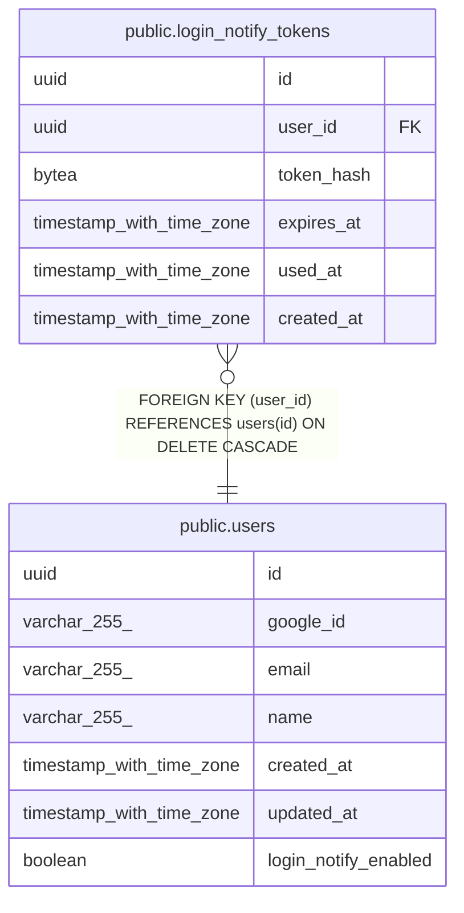

# public.login_notify_tokens

## Description

ログイン通知メール内の全端末ログアウト用使い捨てトークン(平文は保存しない)

## Columns

| Name | Type | Default | Nullable | Children | Parents | Comment |
| ---- | ---- | ------- | -------- | -------- | ------- | ------- |
| id | uuid | gen_random_uuid() | false |  |  |  |
| user_id | uuid |  | false |  | [public.users](public.users.md) |  |
| token_hash | bytea |  | false |  |  |  |
| expires_at | timestamp with time zone | (now() + '24:00:00'::interval) | false |  |  |  |
| used_at | timestamp with time zone |  | true |  |  |  |
| created_at | timestamp with time zone | now() | false |  |  |  |

## Constraints

| Name | Type | Definition |
| ---- | ---- | ---------- |
| login_notify_tokens_user_id_fkey | FOREIGN KEY | FOREIGN KEY (user_id) REFERENCES users(id) ON DELETE CASCADE |
| login_notify_tokens_pkey | PRIMARY KEY | PRIMARY KEY (id) |
| login_notify_tokens_token_hash_key | UNIQUE | UNIQUE (token_hash) |

## Indexes

| Name | Definition |
| ---- | ---------- |
| login_notify_tokens_pkey | CREATE UNIQUE INDEX login_notify_tokens_pkey ON public.login_notify_tokens USING btree (id) |
| login_notify_tokens_token_hash_key | CREATE UNIQUE INDEX login_notify_tokens_token_hash_key ON public.login_notify_tokens USING btree (token_hash) |
| idx_login_notify_tokens_user_created | CREATE INDEX idx_login_notify_tokens_user_created ON public.login_notify_tokens USING btree (user_id, created_at DESC) |

## Relations

---

> Generated by [tbls](https://github.com/k1LoW/tbls)
