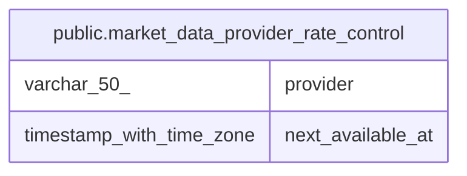

# public.market_data_provider_rate_control

## Description

外部APIの呼び出し間隔(全インスタンス共有)

## Columns

| Name | Type | Default | Nullable | Children | Parents | Comment |
| ---- | ---- | ------- | -------- | -------- | ------- | ------- |
| provider | varchar(50) |  | false |  |  |  |
| next_available_at | timestamp with time zone | now() | false |  |  | 次の呼び出し可能時刻 |

## Constraints

| Name | Type | Definition |
| ---- | ---- | ---------- |
| market_data_provider_rate_control_pkey | PRIMARY KEY | PRIMARY KEY (provider) |

## Indexes

| Name | Definition |
| ---- | ---------- |
| market_data_provider_rate_control_pkey | CREATE UNIQUE INDEX market_data_provider_rate_control_pkey ON public.market_data_provider_rate_control USING btree (provider) |

## Relations

---

> Generated by [tbls](https://github.com/k1LoW/tbls)
