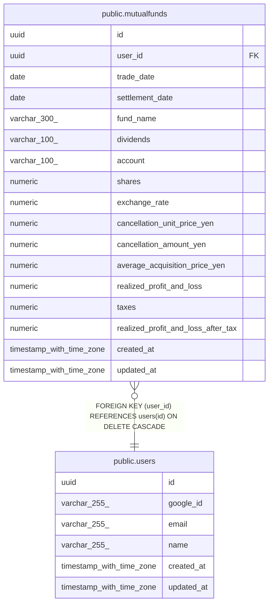

# public.mutualfunds

## Description

投資信託の取引明細(CSV 取込)

## Columns

| Name | Type | Default | Nullable | Children | Parents | Comment |
| ---- | ---- | ------- | -------- | -------- | ------- | ------- |
| id | uuid | gen_random_uuid() | false |  |  |  |
| user_id | uuid |  | false |  | [public.users](public.users.md) |  |
| trade_date | date |  | false |  |  |  |
| settlement_date | date |  | false |  |  |  |
| fund_name | varchar(300) |  | false |  |  |  |
| dividends | varchar(100) |  | true |  |  |  |
| account | varchar(100) |  | false |  |  |  |
| shares | numeric |  | false |  |  |  |
| exchange_rate | numeric |  | false |  |  |  |
| cancellation_unit_price_yen | numeric |  | false |  |  |  |
| cancellation_amount_yen | numeric |  | false |  |  |  |
| average_acquisition_price_yen | numeric |  | false |  |  |  |
| realized_profit_and_loss | numeric |  | false |  |  |  |
| taxes | numeric |  | false |  |  |  |
| realized_profit_and_loss_after_tax | numeric |  | false |  |  |  |
| created_at | timestamp with time zone | now() | false |  |  |  |
| updated_at | timestamp with time zone | now() | false |  |  |  |

## Constraints

| Name | Type | Definition |
| ---- | ---- | ---------- |
| mutualfunds_user_id_fkey | FOREIGN KEY | FOREIGN KEY (user_id) REFERENCES users(id) ON DELETE CASCADE |
| mutualfunds_pkey | PRIMARY KEY | PRIMARY KEY (id) |

## Indexes

| Name | Definition |
| ---- | ---------- |
| mutualfunds_pkey | CREATE UNIQUE INDEX mutualfunds_pkey ON public.mutualfunds USING btree (id) |
| idx_mutualfunds_fund_name_trgm | CREATE INDEX idx_mutualfunds_fund_name_trgm ON public.mutualfunds USING gin (fund_name gin_trgm_ops) |
| idx_mutualfunds_unique | CREATE UNIQUE INDEX idx_mutualfunds_unique ON public.mutualfunds USING btree (user_id, trade_date, fund_name, shares, cancellation_amount_yen, account) |
| idx_mutualfunds_user_account | CREATE INDEX idx_mutualfunds_user_account ON public.mutualfunds USING btree (user_id, account) |
| idx_mutualfunds_user_dividends | CREATE INDEX idx_mutualfunds_user_dividends ON public.mutualfunds USING btree (user_id, dividends) |
| idx_mutualfunds_user_fund_name | CREATE INDEX idx_mutualfunds_user_fund_name ON public.mutualfunds USING btree (user_id, fund_name) |
| idx_mutualfunds_user_trade_date_id | CREATE INDEX idx_mutualfunds_user_trade_date_id ON public.mutualfunds USING btree (user_id, trade_date DESC, id DESC) |

## Relations

---

> Generated by [tbls](https://github.com/k1LoW/tbls)
