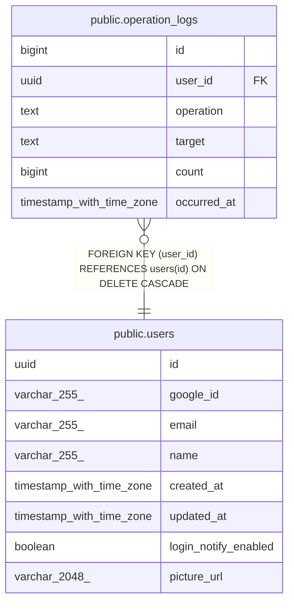

# public.operation_logs

## Description

重要な操作の記録。金額・銘柄・IP の生の値は保存しない

## Columns

| Name | Type | Default | Nullable | Children | Parents | Comment |
| ---- | ---- | ------- | -------- | -------- | ------- | ------- |
| id | bigint | nextval('operation_logs_id_seq'::regclass) | false |  |  |  |
| user_id | uuid |  | false |  | [public.users](public.users.md) |  |
| operation | text |  | false |  |  | 操作の種類 |
| target | text |  | false |  |  | 対象のデータ種類 |
| count | bigint |  | false |  |  | 操作で影響した件数 |
| occurred_at | timestamp with time zone | now() | false |  |  | 操作日時 |

## Constraints

| Name | Type | Definition |
| ---- | ---- | ---------- |
| operation_logs_count_check | CHECK | CHECK ((count >= 0)) |
| operation_logs_operation_check | CHECK | CHECK ((operation = ANY (ARRAY['csv_delete'::text, 'logout_all'::text, 'device_revoke'::text]))) |
| operation_logs_operation_target | CHECK | CHECK ((((operation = 'csv_delete'::text) AND (target = ANY (ARRAY['dividends'::text, 'domestic_stocks'::text, 'mutualfunds'::text, 'asset_balances'::text, 'fund_balances'::text]))) OR ((operation = 'logout_all'::text) AND (target = 'sessions'::text)) OR ((operation = 'device_revoke'::text) AND (target = 'device'::text)))) |
| operation_logs_target_check | CHECK | CHECK ((target = ANY (ARRAY['dividends'::text, 'domestic_stocks'::text, 'mutualfunds'::text, 'asset_balances'::text, 'fund_balances'::text, 'sessions'::text, 'device'::text]))) |
| operation_logs_user_id_fkey | FOREIGN KEY | FOREIGN KEY (user_id) REFERENCES users(id) ON DELETE CASCADE |
| operation_logs_pkey | PRIMARY KEY | PRIMARY KEY (id) |

## Indexes

| Name | Definition |
| ---- | ---------- |
| operation_logs_pkey | CREATE UNIQUE INDEX operation_logs_pkey ON public.operation_logs USING btree (id) |
| operation_logs_user_occurred_idx | CREATE INDEX operation_logs_user_occurred_idx ON public.operation_logs USING btree (user_id, occurred_at DESC, id DESC) |
| operation_logs_occurred_idx | CREATE INDEX operation_logs_occurred_idx ON public.operation_logs USING btree (occurred_at) |

## Relations

---

> Generated by [tbls](https://github.com/k1LoW/tbls)
