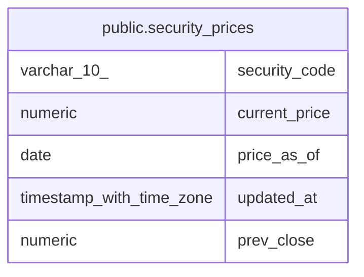

# public.security_prices

## Description

銘柄ごとの共有株価

## Columns

| Name | Type | Default | Nullable | Children | Parents | Comment |
| ---- | ---- | ------- | -------- | -------- | ------- | ------- |
| security_code | varchar(10) |  | false |  |  |  |
| current_price | numeric | 0 | false |  |  |  |
| price_as_of | date |  | true |  |  | 値として確定した基準日 |
| updated_at | timestamp with time zone | now() | false |  |  |  |
| prev_close | numeric |  | true |  |  | 前日終値 |

## Constraints

| Name | Type | Definition |
| ---- | ---- | ---------- |
| security_prices_pkey | PRIMARY KEY | PRIMARY KEY (security_code) |

## Indexes

| Name | Definition |
| ---- | ---------- |
| security_prices_pkey | CREATE UNIQUE INDEX security_prices_pkey ON public.security_prices USING btree (security_code) |

## Relations

---

> Generated by [tbls](https://github.com/k1LoW/tbls)
