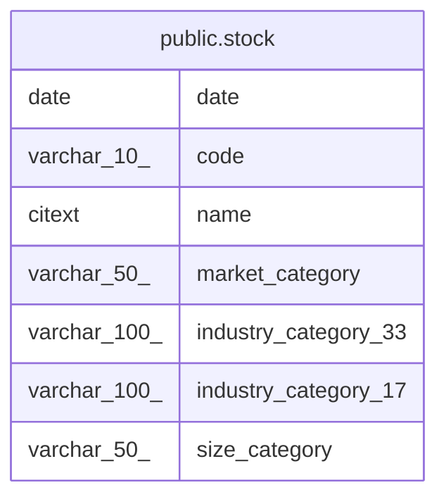

# public.stock

## Description

上場銘柄のマスタ(共有)

## Columns

| Name | Type | Default | Nullable | Children | Parents | Comment |
| ---- | ---- | ------- | -------- | -------- | ------- | ------- |
| date | date |  | false |  |  |  |
| code | varchar(10) |  | false |  |  |  |
| name | citext |  | false |  |  |  |
| market_category | varchar(50) |  | false |  |  |  |
| industry_category_33 | varchar(100) |  | true |  |  |  |
| industry_category_17 | varchar(100) |  | true |  |  |  |
| size_category | varchar(50) |  | true |  |  |  |

## Constraints

| Name | Type | Definition |
| ---- | ---- | ---------- |
| stock_pkey | PRIMARY KEY | PRIMARY KEY (code) |

## Indexes

| Name | Definition |
| ---- | ---------- |
| stock_pkey | CREATE UNIQUE INDEX stock_pkey ON public.stock USING btree (code) |
| idx_stock_name_trgm | CREATE INDEX idx_stock_name_trgm ON public.stock USING gin (name gin_trgm_ops) |

## Relations

---

> Generated by [tbls](https://github.com/k1LoW/tbls)
