# public.users

## Description

Google 認証のユーザー

## Columns

| Name | Type | Default | Nullable | Children | Parents | Comment |
| ---- | ---- | ------- | -------- | -------- | ------- | ------- |
| id | uuid | gen_random_uuid() | false | [public.sessions](public.sessions.md) [public.dividends](public.dividends.md) [public.domestic_stocks](public.domestic_stocks.md) [public.mutualfunds](public.mutualfunds.md) [public.asset_balances](public.asset_balances.md) [public.fund_balances](public.fund_balances.md) [public.csv_import_history](public.csv_import_history.md) [public.login_events](public.login_events.md) [public.admin_login_views](public.admin_login_views.md) [public.login_notify_tokens](public.login_notify_tokens.md) |  |  |
| google_id | varchar(255) |  | false |  |  |  |
| email | varchar(255) |  | false |  |  |  |
| name | varchar(255) |  | true |  |  |  |
| created_at | timestamp with time zone | now() | false |  |  |  |
| updated_at | timestamp with time zone | now() | false |  |  |  |
| login_notify_enabled | boolean | true | false |  |  | 新しい端末・場所変化のログイン通知を受け取るか |
| picture_url | varchar(2048) |  | true |  |  | Google プロフィール画像の URL(googleusercontent の https のみ。未設定・他ホストは NULL) |

## Constraints

| Name | Type | Definition |
| ---- | ---- | ---------- |
| users_google_id_key | UNIQUE | UNIQUE (google_id) |
| users_pkey | PRIMARY KEY | PRIMARY KEY (id) |

## Indexes

| Name | Definition |
| ---- | ---------- |
| users_google_id_key | CREATE UNIQUE INDEX users_google_id_key ON public.users USING btree (google_id) |
| users_pkey | CREATE UNIQUE INDEX users_pkey ON public.users USING btree (id) |

## Relations

```mermaid
erDiagram

"public.sessions" }o--|| "public.users" : "FOREIGN KEY (user_id) REFERENCES users(id) ON DELETE CASCADE"
"public.dividends" }o--|| "public.users" : "FOREIGN KEY (user_id) REFERENCES users(id) ON DELETE CASCADE"
"public.domestic_stocks" }o--|| "public.users" : "FOREIGN KEY (user_id) REFERENCES users(id) ON DELETE CASCADE"
"public.mutualfunds" }o--|| "public.users" : "FOREIGN KEY (user_id) REFERENCES users(id) ON DELETE CASCADE"
"public.asset_balances" }o--|| "public.users" : "FOREIGN KEY (user_id) REFERENCES users(id) ON DELETE CASCADE"
"public.fund_balances" }o--|| "public.users" : "FOREIGN KEY (user_id) REFERENCES users(id) ON DELETE CASCADE"
"public.csv_import_history" }o--|| "public.users" : "FOREIGN KEY (user_id) REFERENCES users(id) ON DELETE CASCADE"
"public.login_events" }o--|| "public.users" : "FOREIGN KEY (user_id) REFERENCES users(id) ON DELETE CASCADE"
"public.admin_login_views" }o--|| "public.users" : "FOREIGN KEY (user_id) REFERENCES users(id) ON DELETE CASCADE"
"public.login_notify_tokens" }o--|| "public.users" : "FOREIGN KEY (user_id) REFERENCES users(id) ON DELETE CASCADE"

"public.users" {
  uuid id
  varchar_255_ google_id
  varchar_255_ email
  varchar_255_ name
  timestamp_with_time_zone created_at
  timestamp_with_time_zone updated_at
  boolean login_notify_enabled
  varchar_2048_ picture_url
}
"public.sessions" {
  uuid id
  uuid user_id FK
  timestamp_with_time_zone created_at
  timestamp_with_time_zone expires_at
  bytea token_hash
  bytea device_hash
}
"public.dividends" {
  uuid id
  uuid user_id FK
  date settlement_date
  varchar_100_ product
  varchar_100_ account
  varchar_10_ security_code
  varchar_200_ security_name
  numeric unit_price
  numeric shares
  numeric dividends_before_tax
  numeric taxes
  numeric net_amount_received
  timestamp_with_time_zone created_at
  timestamp_with_time_zone updated_at
}
"public.domestic_stocks" {
  uuid id
  uuid user_id FK
  date trade_date
  date settlement_date
  varchar_10_ security_code
  varchar_200_ security_name
  varchar_100_ account
  numeric shares
  numeric asked_price
  numeric proceeds
  numeric purchase_price
  numeric realized_profit_and_loss
  numeric taxes
  numeric realized_profit_and_loss_after_tax
  text content_hash
  integer occurrence_index
  timestamp_with_time_zone created_at
  timestamp_with_time_zone updated_at
}
"public.mutualfunds" {
  uuid id
  uuid user_id FK
  date trade_date
  date settlement_date
  varchar_300_ fund_name
  varchar_100_ dividends
  varchar_100_ account
  numeric shares
  numeric exchange_rate
  numeric cancellation_unit_price_yen
  numeric cancellation_amount_yen
  numeric average_acquisition_price_yen
  numeric realized_profit_and_loss
  numeric taxes
  numeric realized_profit_and_loss_after_tax
  timestamp_with_time_zone created_at
  timestamp_with_time_zone updated_at
}
"public.asset_balances" {
  uuid id
  uuid user_id FK
  varchar_10_ security_code
  varchar_200_ security_name
  numeric shares
  numeric average_purchase_price
  numeric total_purchase_amount
  numeric csv_current_price
  numeric csv_daily_change
  timestamp_with_time_zone created_at
  timestamp_with_time_zone updated_at
  varchar_100_ account
}
"public.fund_balances" {
  uuid id
  uuid user_id FK
  varchar_200_ fund_name
  varchar_100_ account
  varchar_50_ dividends_course
  numeric shares
  numeric average_purchase_price
  numeric total_purchase_amount
  numeric base_price
  numeric base_price_day_change
  numeric base_price_month_change
  numeric market_value
  numeric profit_loss
  numeric profit_loss_rate
  numeric total_return
  date price_as_of
  timestamp_with_time_zone created_at
  timestamp_with_time_zone updated_at
  text normalized_fund_name
}
"public.csv_import_history" {
  uuid user_id FK
  text kind
  timestamp_with_time_zone last_imported_at
}
"public.login_events" {
  uuid id
  uuid user_id FK
  timestamp_with_time_zone occurred_at
  text result
  bytea device_hash
  text country
  text region
  text browser
  text os
}
"public.admin_login_views" {
  uuid id
  uuid user_id FK
  timestamp_with_time_zone occurred_at
}
"public.login_notify_tokens" {
  uuid id
  uuid user_id FK
  bytea token_hash
  timestamp_with_time_zone expires_at
  timestamp_with_time_zone used_at
  timestamp_with_time_zone created_at
}
```

---

> Generated by [tbls](https://github.com/k1LoW/tbls)
