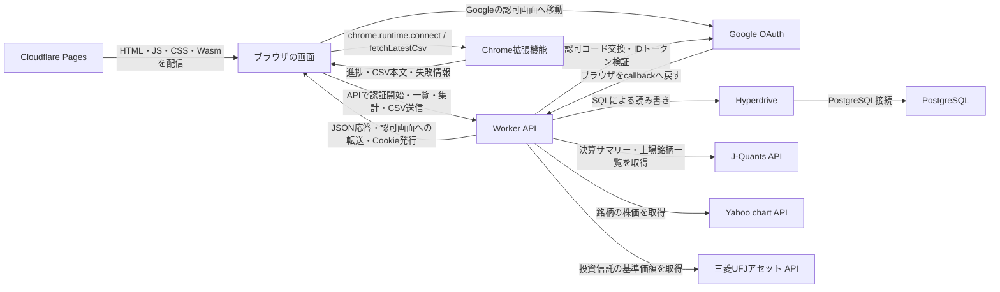
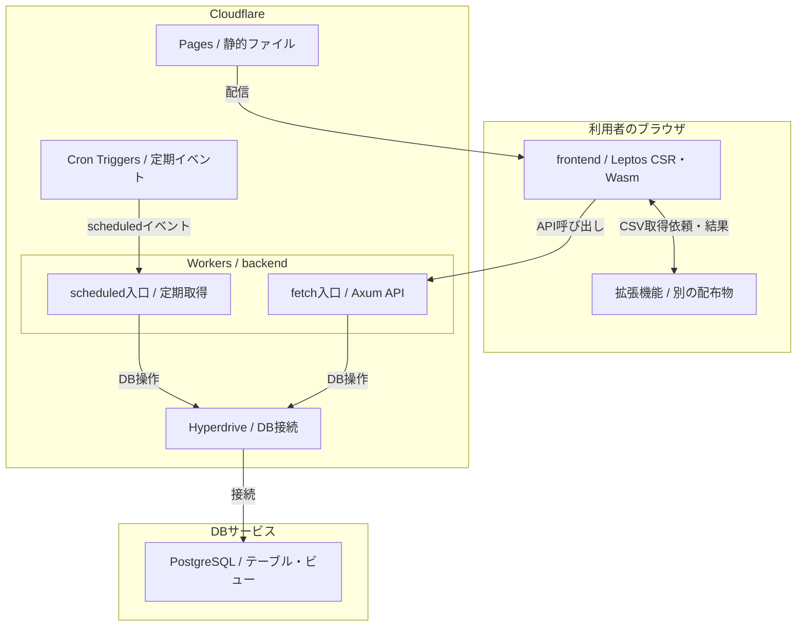

# システム全体と配置

フロントエンドは利用者の画面を動かす部分、バックエンドは認証・保存・外部取得を担う部分。APIは、それらがデータを受け渡す窓口を指す。
LeptosはRustで画面を書く仕組み。CSRはブラウザ側で画面を組み立てる方式で、Wasmはブラウザなどで動かすコンパイル済みの形式。
Cloudflare Pagesは静的ファイルの配信先、Cloudflare Workersはリクエストや定期イベントで処理を実行する環境、Workerはそこに配置するプログラム。
HyperdriveはWorkerとPostgreSQLの接続を仲介する仕組み。SupabaseはPostgreSQLを提供するサービスで、このアプリのDB配置先として既存の構成文書に記載されている。
OAuthは、Googleでのログイン結果を受けてアプリへログインするための認可の仕組み。callbackは、認可画面から戻るAPIの入口。
JSONはAPIの応答に使うデータ形式、Cookieはブラウザが保存して通信時に送る小さな値。セッションは、ログイン状態をサーバー側で識別する仕組み。
CSVはカンマで項目を区切るファイル形式、SQLはDBに読み書きを指示する言語。
J-Quantsは決算や上場銘柄の情報を取得する外部API。基準価額は投資信託の1万口あたりの価格。

## 通信する相手

この図で分かること: 画面の取得、データの読み書き、拡張機能との連携、外部情報の取得を誰が担当するか。
矢印は通信内容を表す。ブラウザと拡張機能の間はブラウザ内のメッセージ通信、それ以外のHTTP通信はHTTPS。

根拠:

- [frontend/src/api/client.rs:147](../../frontend/src/api/client.rs#L147)、[同:246](../../frontend/src/api/client.rs#L246): 配信時に埋めたAPI接続先を読み、Cookie付きでHTTP送信する。
- [frontend/src/features/csv_sync/port.rs:113](../../frontend/src/features/csv_sync/port.rs#L113)、[同:173](../../frontend/src/features/csv_sync/port.rs#L173)、[同:230](../../frontend/src/features/csv_sync/port.rs#L230): 拡張機能への接続、取得依頼、応答の読み取り。
- [frontend/src/features/csv_sync/import.rs:183](../../frontend/src/features/csv_sync/import.rs#L183): 受け取ったCSVも検証APIから取込APIへ渡す。
- [backend/src/handlers/v1/auth/oauth.rs:99](../../backend/src/handlers/v1/auth/oauth.rs#L99)、[同:140](../../backend/src/handlers/v1/auth/oauth.rs#L140)、[backend/src/services/auth/google_worker.rs:82](../../backend/src/services/auth/google_worker.rs#L82): 認可画面への転送、callback、Googleへの交換・検証処理。
- [backend/src/worker_entry.rs:123](../../backend/src/worker_entry.rs#L123)、[backend/src/db.rs:454](../../backend/src/db.rs#L454)、[同:472](../../backend/src/db.rs#L472): Hyperdriveから接続を作り、PostgreSQLの通信を行う。
- [backend/src/services/jquants.rs:13](../../backend/src/services/jquants.rs#L13)、[backend/src/services/jquants/client_worker.rs:9](../../backend/src/services/jquants/client_worker.rs#L9)、[同:36](../../backend/src/services/jquants/client_worker.rs#L36): 決算・銘柄一覧の取得。
- [backend/src/services/stock_price.rs:144](../../backend/src/services/stock_price.rs#L144)、[backend/src/services/fund_price.rs:159](../../backend/src/services/fund_price.rs#L159): 株価・基準価額のHTTP取得。
- [.github/workflows/frontend.yml:109](../../.github/workflows/frontend.yml#L109)、[.github/workflows/deploy-cloudflare-pages.yml:190](../../.github/workflows/deploy-cloudflare-pages.yml#L190): 画面のビルドとPagesへの配置。

図のDB名をPostgreSQLまでに留めたのは、接続コードが提供会社を固定していないため。本番の配置先がSupabaseであるという記録は [docs/architecture.md:36](../architecture.md#L36) と [.github/workflows/db-backup.yml:3](../../.github/workflows/db-backup.yml#L3) にあるが、接続先の実値は調査・転載していない。
拡張機能から証券サイトへCSVを取りに行く内部処理はこのリポジトリにないため、図は受け渡しの境界までとする。

## どこで何が動くか

AxumはAPIの入口を振り分けるRustの仕組み。Cron Triggersは指定した時刻にWorkerへイベントを渡す設定。ビューは保存済みの表を組み合わせ、読み取り時に結果を返すDBの仕組み。

この図で分かること: 画面はブラウザ、APIと定期処理はWorker、永続データはDBで扱うという実行場所の分担。
枠は配置場所、矢印は配信・呼び出し・接続を表す。定期処理もAPIと同じWorkerプログラムの入口を使う。

根拠:

- [frontend/Cargo.toml:12](../../frontend/Cargo.toml#L12)、[frontend/src/main.rs:13](../../frontend/src/main.rs#L13): CSRと画面の起動。
- [.github/workflows/deploy-cloudflare-pages.yml:190](../../.github/workflows/deploy-cloudflare-pages.yml#L190): 静的成果物のPagesへの配信。
- [frontend/src/features/csv_sync/port.rs:146](../../frontend/src/features/csv_sync/port.rs#L146): 別の拡張機能への接続。
- [backend/src/worker_entry.rs:167](../../backend/src/worker_entry.rs#L167)、[同:199](../../backend/src/worker_entry.rs#L199)、[同:123](../../backend/src/worker_entry.rs#L123): fetchとscheduledが共通のDB接続を構築する。
- [backend/wrangler.toml:12](../../backend/wrangler.toml#L12)、[同:44](../../backend/wrangler.toml#L44): Hyperdriveと定期イベントの設定。
- [backend/src/db.rs:472](../../backend/src/db.rs#L472)、[backend/migrations/0014_asset_balances_account.sql:16](../../backend/migrations/0014_asset_balances_account.sql#L16): PostgreSQL接続とDB側のビュー定義。

定期処理と配信手順は [配信と自動化](03-delivery.md)、保存するものは [データモデル](02-data-model.md) を参照。

## 未確認

- 稼働中のHyperdriveの接続先、Supabase側の設定・リージョン、実環境のsecretsの登録状況。図には接続文字列・識別子を含めない。
- 拡張機能側のCSV取得実装・証券サイトとの通信・拡張機能の配布手順。
- Google・市場データAPIの実応答と本番での最新の取得成功状況。

## 文書との食い違い

- 既存の [Pages移行記録](cloudflare-pages.md) と [Workers移行記録](cloudflare-workers-backend.md) の旧構成は履歴として扱い、現在の配置とは混ぜない。
