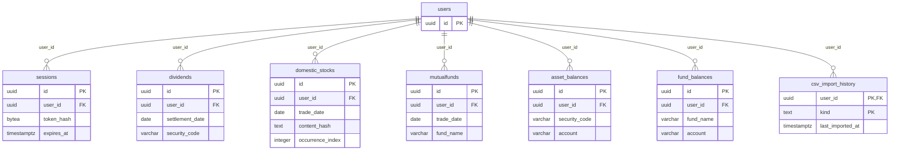
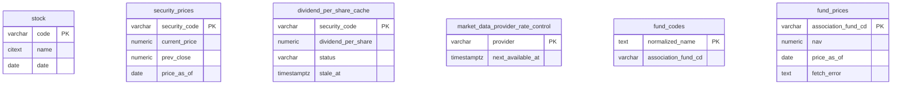
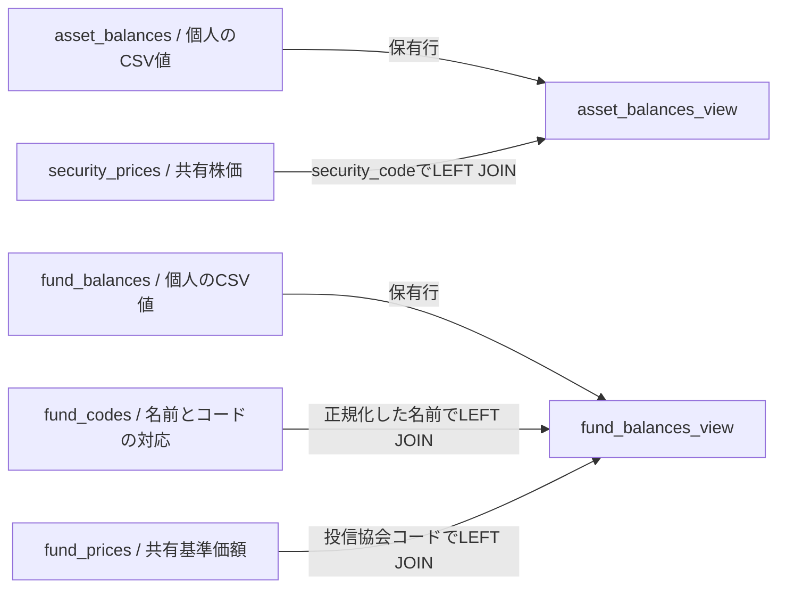

# データモデル

DBはデータを永続保存する場所。ER図は、保存する表と表の関係を示す図。
PK（主キー）は行を一意に識別する列、FK（外部キー）は別の表の行を参照する制約。UUIDは識別子に使う型で、値の例は載せない。
図の型は、`varchar`・`text` が文字列、`citext` が大小文字を区別せず比較する文字列、`numeric` が数値、`integer` が整数、`date` が日付、`timestamptz` がタイムゾーン付き日時、`bytea` がバイナリ列を意味する。
CSVはカンマで項目を区切るファイル形式。取引明細は取引・配当などの過去の事実、保有残高は現在の保有状態を表す。
セッションはログイン状態の識別用で、DBにはCookie（ブラウザが保持・送信する値）そのものではなく照合用のハッシュを保存する。ハッシュは元の値から計算する照合用の値。
この資料は `0000`〜`0017` のマイグレーションを順番に適用した定義を対象とし、読みやすさのため列を絞っている。全列は [自動生成したDB資料](../db/README.md) を参照。
マイグレーションとは、DBの構造変更を順番に適用するSQLファイルのこと。適用対象の登録は [backend/src/db/migrate.rs:15](../../backend/src/db/migrate.rs#L15) にある。

## 個人に属するデータ

この図で分かること: どの表がユーザーに属し、どの列で所有者を結ぶか。
`||--o{` は「子の1行には必ず親が1行、親の1行には子が0行以上」を意味する。線はすべて実際の外部キーで、ユーザー削除時は子も削除される。

根拠:

- [backend/migrations/0001_users.sql:3](../../backend/migrations/0001_users.sql#L3)、[backend/migrations/0002_sessions.sql:3](../../backend/migrations/0002_sessions.sql#L3)、[同:26](../../backend/migrations/0002_sessions.sql#L26): ユーザーとセッションの列・制約。
- [backend/migrations/0003_dividends.sql:3](../../backend/migrations/0003_dividends.sql#L3)、[同:47](../../backend/migrations/0003_dividends.sql#L47): 配当明細と所有者。
- [backend/migrations/0004_domestic_stocks.sql:3](../../backend/migrations/0004_domestic_stocks.sql#L3)、[同:48](../../backend/migrations/0004_domestic_stocks.sql#L48): 国内株式取引と所有者。
- [backend/migrations/0005_mutualfunds.sql:3](../../backend/migrations/0005_mutualfunds.sql#L3)、[同:47](../../backend/migrations/0005_mutualfunds.sql#L47): 投資信託取引と所有者。
- [backend/migrations/0006_asset_balances.sql:3](../../backend/migrations/0006_asset_balances.sql#L3)、[同:32](../../backend/migrations/0006_asset_balances.sql#L32)、[backend/migrations/0014_asset_balances_account.sql:4](../../backend/migrations/0014_asset_balances_account.sql#L4): 国内株式残高と後から追加された口座区分。
- [backend/migrations/0011_fund_balances.sql:4](../../backend/migrations/0011_fund_balances.sql#L4)、[同:40](../../backend/migrations/0011_fund_balances.sql#L40): 投資信託残高と所有者。
- [backend/migrations/0017_csv_import_history.sql:1](../../backend/migrations/0017_csv_import_history.sql#L1): ユーザー・CSV種類の複合主キーと所有者。

セッションのハッシュ計算・保存は [backend/src/services/auth.rs:28](../../backend/src/services/auth.rs#L28)、[同:153](../../backend/src/services/auth.rs#L153) を参照。

| 表 | 主な役割・1行の単位 |
| --- | --- |
| `users` | Google認証のユーザー |
| `sessions` | ユーザーに対応するログインセッションと有効期限 |
| `dividends` | 配当・分配金の受取明細 |
| `domestic_stocks` | 国内株式の売買明細。同内容の複数行は `content_hash` と `occurrence_index` で区別 |
| `mutualfunds` | 投資信託の取引明細 |
| `asset_balances` | ユーザー・銘柄コード・口座区分ごとの国内株式残高 |
| `fund_balances` | CSVで受け取った投資信託残高。ファンド名・口座・分配金コースなどを持つ |
| `csv_import_history` | ユーザー・CSV種類ごとの最終取り込み成功時刻。全取込の履歴一覧ではない |

`asset_balances` の一意性は [0014_asset_balances_account.sql:12](../../backend/migrations/0014_asset_balances_account.sql#L12) にある。`fund_balances` に同じ形の複合一意制約はないため、同じキー構造として扱わない。

## 全ユーザーで共有するデータ

マスタは参照の基礎となる一覧、キャッシュは外部から取得した値を再利用する保存領域。

この図で分かること: ユーザーIDを持たない共有表と、それぞれの主キー。
これらの表同士に外部キーはないため、ER図に関係線は描かない。銘柄コードが似ていても参照制約を意味しない。

根拠:

- [backend/migrations/0007_stock.sql:3](../../backend/migrations/0007_stock.sql#L3)、[backend/migrations/0010_security_prices.sql:3](../../backend/migrations/0010_security_prices.sql#L3): 銘柄マスタと共有株価。
- [backend/migrations/0008_dividend_per_share_cache.sql:3](../../backend/migrations/0008_dividend_per_share_cache.sql#L3)、[backend/migrations/0009_market_data_provider_rate_control.sql:3](../../backend/migrations/0009_market_data_provider_rate_control.sql#L3): 1株配当とAPI呼出間隔。
- [backend/migrations/0013_fund_nav.sql:29](../../backend/migrations/0013_fund_nav.sql#L29)、[同:269](../../backend/migrations/0013_fund_nav.sql#L269)、[backend/migrations/0015_fund_nav_fetch_status.sql:5](../../backend/migrations/0015_fund_nav_fetch_status.sql#L5): ファンド名対応表、共有基準価額、取得失敗の列。

| 表 | 主な役割 |
| --- | --- |
| `stock` | J-Quantsから更新する上場銘柄マスタ |
| `security_prices` | Yahooから取得する銘柄ごとの株価・前日終値・基準日 |
| `dividend_per_share_cache` | J-Quantsから取得する1株配当と取得状態・再取得時刻 |
| `market_data_provider_rate_control` | 外部API提供元ごとの次回呼出可能時刻 |
| `fund_codes` | 正規化したファンド名から投信協会コードへの対応表 |
| `fund_prices` | 投信協会コードごとの共有基準価額と取得失敗情報 |

株価取得先は [backend/src/services/stock_price.rs:13](../../backend/src/services/stock_price.rs#L13)、配当の取得経路は [backend/src/worker_entry.rs:294](../../backend/src/worker_entry.rs#L294)、マスタ更新は [同:285](../../backend/src/worker_entry.rs#L285) を参照。
マスタと価格・配当キャッシュを分ける理由は [db-design.md](../db-design.md) と [ADR 0002](../adr/0002-separate-stock-master-and-caches.md) の説明に従う。

## 保存した値を画面用に組み合わせる

ビューは、表を組み合わせて読み取り時に結果を作るDBの仕組み。LEFT JOINは、右側の一致行がなくても左側の行を残す結合。

この図で分かること: 国内株式と投資信託で、どの表から画面用の値を作るか。
矢印は読み取りビューの参照関係であり、外部キーではない。

根拠:

- [backend/migrations/0014_asset_balances_account.sql:16](../../backend/migrations/0014_asset_balances_account.sql#L16): 国内株式ビューの最新定義と `security_code` による結合。
- [backend/migrations/0013_fund_nav.sql:281](../../backend/migrations/0013_fund_nav.sql#L281)、[同:294](../../backend/migrations/0013_fund_nav.sql#L294)、[同:324](../../backend/migrations/0013_fund_nav.sql#L324): ファンド名正規化と2段の結合。

国内株式は共有価格に基準日があれば共有値を使い、それ以外は本人のCSV値を使う。投資信託は共有値の基準日とCSVの取込時刻などで採用元を決め、`price_source`（採用元）と `nav_is_latest`（前日比を最新として表示できるか）も返す。
投資信託ビューの詳しい条件は [0013_fund_nav.sql:318](../../backend/migrations/0013_fund_nav.sql#L318) を参照。単に「APIがあれば常に優先」とは扱わない。

## 未確認

- 本番DBに適用済みのマイグレーションと実際の行数・内容。本資料はSQL定義の確認であり、実データの照会は行っていない。
- DB提供サービス側の権限・外部公開の実設定。SQL定義から本番設定を推測しない。

## 文書との食い違い

- [docs/db-design.md:19](../db-design.md#L19) のテーブル一覧には、`0011`以降で追加された `fund_balances`・`fund_codes`・`fund_prices`・`fund_balances_view`・`csv_import_history` が載っていない。本資料では実際の追加SQLも対象とした。
- 同文書の「派生値は保存しない」は、すべての表の列に一律には当てはまらない。`fund_balances` はCSV由来の `market_value`・`profit_loss` なども保存し、共有値採用時はビューで計算する（[0011_fund_balances.sql:16](../../backend/migrations/0011_fund_balances.sql#L16)、[0013_fund_nav.sql:341](../../backend/migrations/0013_fund_nav.sql#L341)）。
- [docs/architecture.md:68](../architecture.md#L68) のbaseline範囲は `0000〜0009`、[backend/migrations/README.md:11](../../backend/migrations/README.md#L11) は `0000〜0010`。現在の登録対象は `0000〜0017`（[backend/src/db/migrate.rs:15](../../backend/src/db/migrate.rs#L15)）。baselineとその後の追加を区別して読む。
