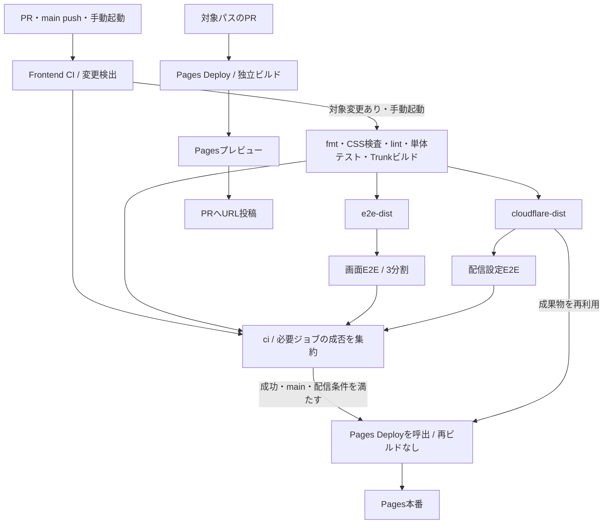
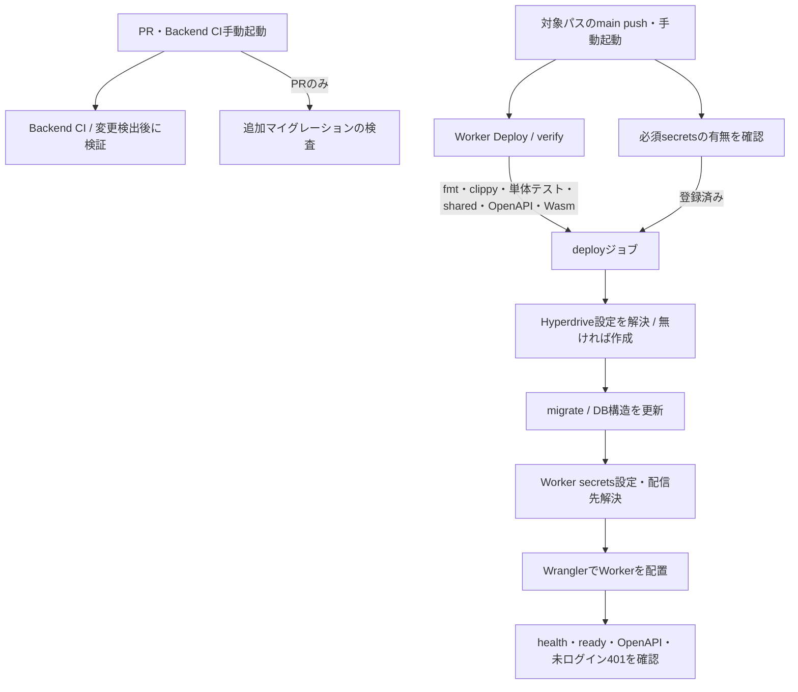
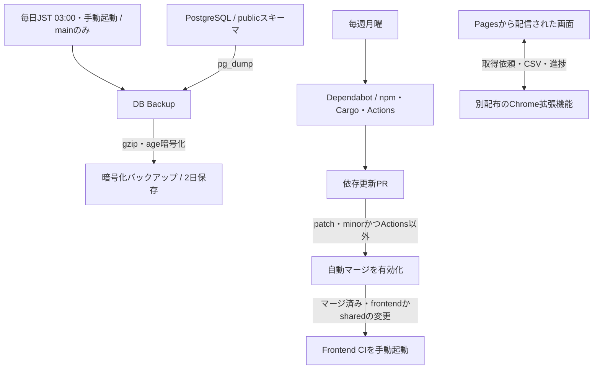
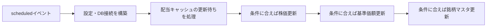

# 配信と自動化

CIは変更を自動検証する仕組み、CDは検証したプログラムを配信する仕組み。このリポジトリではGitHub Actionsのワークフロー（実行手順の定義）で行う。
PRは変更をレビューするための提案、mainは統合先のブランチ、pushはコミットをGitHubへ送る操作。手動起動はGitHub Actionsの `workflow_dispatch` を指す。
アーティファクトはジョブ間で受け渡したり保管したりする成果物。E2Eはブラウザ操作を通して画面の動きを確かめるテスト。
TrunkはRustの画面をブラウザ向けの配信物にまとめるビルドツール。lintは不適切な書き方などの静的な検査、secretsは実行時だけ渡す秘密の設定値。
本資料はワークフローに書かれた条件を示し、各処理が本番で直近に成功したことまでは保証しない。

## フロントエンドの検証から配信まで

この図で分かること: 本番はCIを通した成果物をそのまま配信し、PRプレビューは独立してビルド・配信すること。
各ジョブは対象パスの変更・手動起動などの条件を満たしたときに動く。PRプレビューは権限のある投稿者と必要なsecretsがある場合に限る。

根拠:

- [.github/workflows/frontend.yml:3](../../.github/workflows/frontend.yml#L3)、[同:18](../../.github/workflows/frontend.yml#L18)、[同:50](../../.github/workflows/frontend.yml#L50): 起動条件・変更検出・ビルドの条件と検証内容。
- [.github/workflows/frontend.yml:129](../../.github/workflows/frontend.yml#L129)、[同:150](../../.github/workflows/frontend.yml#L150)、[同:202](../../.github/workflows/frontend.yml#L202): 2種類の成果物、3分割E2E、配信設定E2E。
- [.github/workflows/frontend.yml:250](../../.github/workflows/frontend.yml#L250)、[同:281](../../.github/workflows/frontend.yml#L281): 成否集約とmainからの `use_prebuilt_dist: true` 呼出。
- [.github/workflows/deploy-cloudflare-pages.yml:3](../../.github/workflows/deploy-cloudflare-pages.yml#L3)、[同:58](../../.github/workflows/deploy-cloudflare-pages.yml#L58)、[同:136](../../.github/workflows/deploy-cloudflare-pages.yml#L136): PRの独立経路と成果物選択。
- [.github/workflows/deploy-cloudflare-pages.yml:150](../../.github/workflows/deploy-cloudflare-pages.yml#L150)、[同:190](../../.github/workflows/deploy-cloudflare-pages.yml#L190)、[同:218](../../.github/workflows/deploy-cloudflare-pages.yml#L218): 配信先判定・配信・URL投稿。

Pages Deployはmainなら本番、それ以外ならプレビューを選ぶ（[deploy-cloudflare-pages.yml:150](../../.github/workflows/deploy-cloudflare-pages.yml#L150)）。同ワークフローをmainで直接手動起動した場合は、Frontend CIを待たず、独立ビルドして本番へ配信する。
PRプレビューはFrontend CIの成功待ちではなく、最新コミットかを別に確認して配信する。本番APIはプレビューからのアクセスを許可しないため、見た目の確認用（[frontend/README.md:192](../../frontend/README.md#L192)、[backend/src/config/cors.rs](../../backend/src/config/cors.rs)）。
Markdownだけの変更はフロント変更の対象から除外される。変更なしの場合も `ci` が変更検出の成功を確認する。

## バックエンドの検証とWorker配置

マイグレーションはDB構造の更新、スモーク確認は配信後の最低限の疎通確認。HyperdriveはWorkerとPostgreSQLの接続を仲介する仕組み。
OpenAPIはAPIの入出力を機械可読な形式で定義した契約、sharedはフロントエンドとバックエンドが共用するRustコード、WranglerはCloudflareへ配置するためのコマンドツール。Wasmは配信プログラムのコンパイル形式。

この図で分かること: PRの検証とmainの配信は別経路で、配信時はDB更新がWorker配置より先に行われること。
図のWorker Deployは必要なsecretsが登録済みでmain上の場合にのみ配置へ進む。

根拠:

- [.github/workflows/backend.yml:3](../../.github/workflows/backend.yml#L3)、[同:37](../../.github/workflows/backend.yml#L37)、[同:73](../../.github/workflows/backend.yml#L73)、[同:107](../../.github/workflows/backend.yml#L107): PR・手動起動、対象変更の検出、検証とmigration guard。
- [.github/workflows/deploy-cloudflare-worker.yml:5](../../.github/workflows/deploy-cloudflare-worker.yml#L5)、[同:28](../../.github/workflows/deploy-cloudflare-worker.yml#L28)、[同:60](../../.github/workflows/deploy-cloudflare-worker.yml#L60)、[同:110](../../.github/workflows/deploy-cloudflare-worker.yml#L110): 起動条件、secrets、verify、mainへの制限。
- [.github/workflows/deploy-cloudflare-worker.yml:163](../../.github/workflows/deploy-cloudflare-worker.yml#L163)、[同:189](../../.github/workflows/deploy-cloudflare-worker.yml#L189)、[同:193](../../.github/workflows/deploy-cloudflare-worker.yml#L193)、[同:228](../../.github/workflows/deploy-cloudflare-worker.yml#L228)、[同:248](../../.github/workflows/deploy-cloudflare-worker.yml#L248): 接続設定・DB更新・配置・疎通確認の順序。
- [backend/src/bin/migrate.rs](../../backend/src/bin/migrate.rs)、[backend/src/db/migrate.rs:15](../../backend/src/db/migrate.rs#L15): ホスト側で動くDB更新プログラムと適用ファイルの登録。

初回にWorkerの配信先が未作成なら、配信先確定用の `wrangler deploy` も行う（[deploy-cloudflare-worker.yml:216](../../.github/workflows/deploy-cloudflare-worker.yml#L216)）。
DB更新中は旧Workerが稼働しうる。列の削除・改名を、その列の使用をやめるWorkerと同時に配信しないという運用は [backend/migrations/README.md](../../backend/migrations/README.md) を参照。
図のDB更新はGitHubのランナーから行い、Workerのリクエスト処理中に実行しない。ランナーはActionsのジョブを実行するマシンを指す。

## バックアップ・依存更新・拡張機能との関係

Dependabotは依存ライブラリの更新PRを作る仕組み。pg_dumpはDBを書き出すツール、gzipは圧縮、ageは公開鍵を使って暗号化するツール。
patch・minor・majorは依存のバージョン更新の区分。npmはJavaScript、CargoはRustの依存を管理する仕組み。

この図で分かること: バックアップと依存更新は別の自動処理で、拡張機能はこのリポジトリの配信対象に含まれないこと。
拡張機能との矢印は実行時のメッセージ連携を表し、拡張機能へのデプロイを意味しない。

根拠:

- [.github/workflows/db-backup.yml:8](../../.github/workflows/db-backup.yml#L8)、[同:27](../../.github/workflows/db-backup.yml#L27)、[同:44](../../.github/workflows/db-backup.yml#L44)、[同:55](../../.github/workflows/db-backup.yml#L55): 起動時刻・main制限・暗号化成果物・保存日数。
- [scripts/db-backup.sh:58](../../scripts/db-backup.sh#L58): publicスキーマを書き出して圧縮・暗号化する。平文のバックアップを成果物へ載せない。
- [.github/dependabot.yml:1](../../.github/dependabot.yml#L1): npm・backend Cargo・frontend Cargo・GitHub Actionsの更新周期。
- [.github/workflows/dependabot-auto-merge.yml:16](../../.github/workflows/dependabot-auto-merge.yml#L16)、[同:28](../../.github/workflows/dependabot-auto-merge.yml#L28)、[同:40](../../.github/workflows/dependabot-auto-merge.yml#L40): 対象更新だけ自動マージを有効化し、マージ確認後にFrontend CIを起動する条件。
- [frontend/src/features/csv_sync/port.rs:113](../../frontend/src/features/csv_sync/port.rs#L113)、[同:173](../../frontend/src/features/csv_sync/port.rs#L173)、[同:230](../../frontend/src/features/csv_sync/port.rs#L230): 拡張機能への取得依頼と結果の受信。
- [.github/workflows/deploy-cloudflare-pages.yml:190](../../.github/workflows/deploy-cloudflare-pages.yml#L190)、[.github/workflows/deploy-cloudflare-worker.yml:228](../../.github/workflows/deploy-cloudflare-worker.yml#L228): 本リポジトリの配置先はPagesとWorker。

majorとGitHub Actionsの更新は自動マージ対象外で、対象外へ変わったPRでは自動マージ設定を解除する。
自動マージの有効化は即時マージ完了を意味しない。後続の起動処理はPRがマージ済みになったかを確認する。
この補完処理が明示的に起動するのはFrontend CIだけで、Worker Deployの起動はここには書かれていない。
バックアップ保存日数はワークフローの指定であり、復元成功を保証するものではない。

## Workerの定期取得

scheduledはWorkerに届く定期イベント。キャッシュは外部から得た値を再利用するための保存領域。

この図で分かること: 定期イベントの1回の処理で、配当・株価・投資信託価格・銘柄マスタを順に処理すること。
株価・基準価額・マスタは処理時刻の条件を満たす場合だけ取得する。J-Quantsの設定がなければ配当とマスタの処理は省略される。

根拠:

- [backend/src/worker_entry.rs:199](../../backend/src/worker_entry.rs#L199)、[同:210](../../backend/src/worker_entry.rs#L210)、[同:220](../../backend/src/worker_entry.rs#L220)、[同:235](../../backend/src/worker_entry.rs#L235)、[同:250](../../backend/src/worker_entry.rs#L250): 実行順序と時刻判定。
- [backend/src/worker_entry.rs:285](../../backend/src/worker_entry.rs#L285)、[同:294](../../backend/src/worker_entry.rs#L294): J-Quantsクライアントがない場合は処理しない。
- [backend/wrangler.toml:44](../../backend/wrangler.toml#L44): 定期イベントは毎分。各処理の実行要否はコード側でも判定する。

途中の取得失敗は記録し、後続の種類の処理も続ける。最初の設定構築で失敗した場合はその回を終了する。
詳細な取得条件・再試行の設計は担当Cの範囲とし、ここではイベント内のつながりまでを扱う。

## 未確認

- GitHub側の本番配信有効化・secrets・ブランチ保護・必須チェックの実設定と、直近のActions実行結果。
- バックアップからの復元実行と成功、拡張機能側のCI・配布・リリース手順。
- この資料では手順を説明しただけで、デプロイ・バックアップ・依存更新のワークフローを起動していない。

## 文書との食い違い

- [backend/migrations/README.md:47](../../backend/migrations/README.md#L47) とWorker Deploy内のコメントには旧接続先のNeonが残る。実処理はGitHubの `DATABASE_URL` から接続するため、本資料では提供会社をコードから断定せずPostgreSQLと表記した。
- [Pages移行記録](cloudflare-pages.md) のプレビュー案には本番APIを使う移行時の想定が残る。現行の [frontend/README.md:196](../../frontend/README.md#L196) は見た目確認専用と明記しているため、その制限に従った。
- [Pages移行記録](cloudflare-pages.md) には `LEPTOS_PRODUCTION_ENABLED` の分岐があるが、現行の配信先判定はmainかどうかで行う（[deploy-cloudflare-pages.yml:150](../../.github/workflows/deploy-cloudflare-pages.yml#L150)）。
