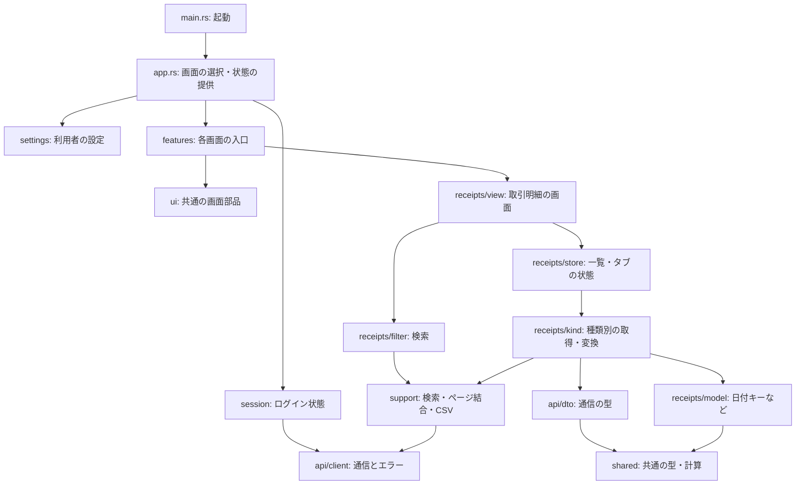
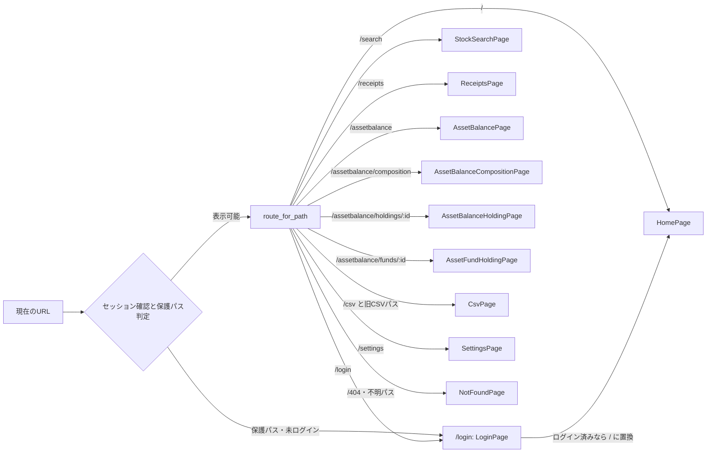
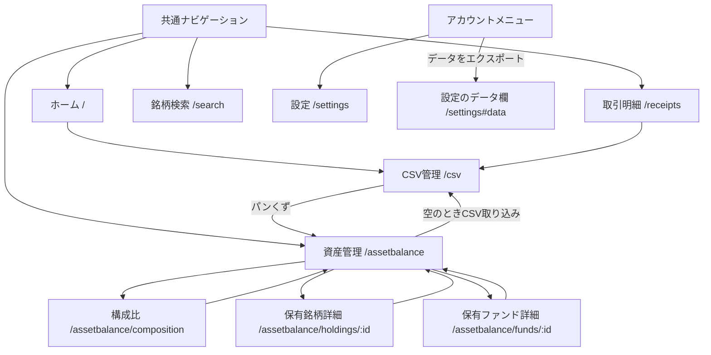

# フロントエンドの構造と画面遷移

対象: Issue #1601（担当B）。調査基準: `f3a08731` のソースコード。

| 用語 | 意味 |
| --- | --- |
| Leptos・CSR | Leptos は Rust で画面と状態の連動を書くライブラリで、このアプリではブラウザ内で画面を作る CSR（クライアント側描画）を使う。 |
| Wasm | Wasm はブラウザで Rust のビルド結果を実行する形式。 |

起動・状態・通信の順序は [処理のシーケンス](12-frontend-sequences.md) を参照。

配信・移行の説明は既存の [Cloudflare Pages 移行記録](cloudflare-pages.md)・[Cloudflare Workers 移行記録](cloudflare-workers-backend.md) に任せ、ここではフロントエンド内部を扱う。
現行のシステム全体は [architecture.md](../architecture.md)、境界の方針は [ADR 0001](../adr/0001-keep-axum-and-harden-api.md) を参照する。

## コンポーネントと依存

| 用語 | 意味 |
| --- | --- |
| コンポーネント | コンポーネントは、画面や機能を組み立てる部品。 |
| ストア・モデル | ストア（store）は画面の状態と非同期処理を持つ場所。モデル（model）は表示用の値の計算などを行う場所。 |
| API・DTO | API はバックエンドとの通信窓口、DTO は通信で受け渡すデータの型。 |

以下の矢印は、呼び出しまたは型・関数の参照を表す。

この図で分かること: `app` が画面・共通状態を組み立て、機能が共通部品と通信処理を使う。
`model` は最上位のディレクトリではなく、各機能の中にある。取引明細を例に内部も示す。

根拠:

- [`frontend/src/main.rs:13`](../../frontend/src/main.rs#L13): `App` をブラウザの本文へ取り付ける。
- [`frontend/src/app.rs:247`](../../frontend/src/app.rs#L247): 設定・セッション・CSV同期状態の提供と画面の選択。
- [`frontend/src/features/receipts/view.rs:24`](../../frontend/src/features/receipts/view.rs#L24): ストア取得と共通のページ枠。
- [`frontend/src/features/receipts/view/main_content.rs:1`](../../frontend/src/features/receipts/view/main_content.rs#L1): 検索・共通部品の利用。
- [`frontend/src/features/receipts/store.rs:298`](../../frontend/src/features/receipts/store.rs#L298): `tab.fetch_list()` を非同期で実行する。
- [`frontend/src/features/receipts/kind.rs:16`](../../frontend/src/features/receipts/kind.rs#L16): model・support・DTOの参照。取得本体は同ファイルの `load_tab`（930行）。
- [`frontend/src/features/receipts/filter.rs:1`](../../frontend/src/features/receipts/filter.rs#L1): 共通の検索処理への依存。
- [`frontend/src/features/receipts/model.rs:1`](../../frontend/src/features/receipts/model.rs#L1): shared の型・関数と日付キー計算。
- [`frontend/src/support/pagination.rs:49`](../../frontend/src/support/pagination.rs#L49)・[`frontend/src/session.rs:110`](../../frontend/src/session.rs#L110): `ApiClient` の利用。
- [`frontend/src/api/dto.rs:3`](../../frontend/src/api/dto.rs#L3): shared の通信型を再公開する。

図は代表的な依存に絞っている。`features` にはホーム・資産管理・銘柄検索・CSV管理・設定・ログインなどもあり、すべてが同じ内部構造を持つわけではない。

## URL と画面

ルートは、URLのパスと表示する画面の対応。SPA はページ全体を読み込み直さず画面を切り替える方式。

この図で分かること: パスに応じて `App` がどの画面を作るか。これはルートの対応図で、画面間のリンクは次の図に示す。
認証が必要なパスは、セッション確認後に未ログインなら `/login` へ移る。

根拠:

- [`frontend/src/app.rs:69`](../../frontend/src/app.rs#L69): 詳細IDの判定、ルート対応、保護パス判定。
- [`frontend/src/app.rs:342`](../../frontend/src/app.rs#L342): 不明パスを `/404`、未認証の保護パスを `/login`、認証済みのログイン画面を `/` へ置換する。
- [`frontend/src/app.rs:391`](../../frontend/src/app.rs#L391): セッション確認中は読み込み表示、その後に画面を作る。

`/receipts`・`/assetbalance`・`/settings`・`/csv` と、`/receipts/`・`/assetbalance/`・`/settings/` 配下は保護対象。
図の `:id` は説明用の表記で、コードでは空でなく `/` を含まない末尾をIDとして渡す。
クエリ文字列は画面の再描画を起こすが、ルートの判定はパス部分で行う。

| 旧パス | 現在表示する画面 |
| --- | --- |
| `/receipts/conditions` | 取引明細 |
| `/receipts/csv`・`/receipts/csv/delete` | CSV管理 |
| `/assetbalance/csv`・`/assetbalance/csv/delete` | CSV管理 |

旧パスは同じ画面に対応付ける実装で、必ず `/csv` にURLを書き換える実装ではない。

## 主な画面間の導線

この図で分かること: 共通ナビゲーションと、資産管理・取引明細から実際に出ている主なリンク。
認証の判定は上の図の共通処理を通る。

根拠:

- [`frontend/src/ui/site.rs:11`](../../frontend/src/ui/site.rs#L11)・[`frontend/src/ui/site.rs:426`](../../frontend/src/ui/site.rs#L426): ナビゲーションと設定・エクスポートのリンク。
- [`frontend/src/features/home/view.rs:104`](../../frontend/src/features/home/view.rs#L104)・[`frontend/src/features/receipts/view.rs:37`](../../frontend/src/features/receipts/view.rs#L37): CSV管理へのリンク。
- [`frontend/src/features/asset_balance/view/main_content.rs:84`](../../frontend/src/features/asset_balance/view/main_content.rs#L84)・[`frontend/src/features/csv_page.rs:174`](../../frontend/src/features/csv_page.rs#L174): 空表示の取り込みリンクとパンくず。
- [`frontend/src/features/asset_balance/view/summary.rs:394`](../../frontend/src/features/asset_balance/view/summary.rs#L394)・[`frontend/src/features/asset_balance/view/all_list.rs:68`](../../frontend/src/features/asset_balance/view/all_list.rs#L68): 構成比と2種類の詳細へのリンク。
- [`frontend/src/features/asset_balance/view/composition_page.rs:69`](../../frontend/src/features/asset_balance/view/composition_page.rs#L69)・[`frontend/src/features/asset_balance/view/holding_detail_page.rs:70`](../../frontend/src/features/asset_balance/view/holding_detail_page.rs#L70)・[`frontend/src/features/asset_balance/view/fund_detail_page.rs:65`](../../frontend/src/features/asset_balance/view/fund_detail_page.rs#L65): 資産管理へ戻るリンク。
- [`frontend/src/app.rs:216`](../../frontend/src/app.rs#L216)・[`frontend/src/app.rs:256`](../../frontend/src/app.rs#L256): 通常クリックをブラウザ履歴と現在パスの更新に変換する。

通常の同一サイト内のルート相対リンクは `App` が受け取り、履歴・表示・スクロール・フォーカスを更新する。
修飾キー付きクリック、ダウンロード、新しいタブ向けリンクなどはブラウザに任せる。
戻る・進むは `popstate`（ブラウザ履歴の移動通知）で現在パスを更新する（`frontend/src/app.rs:292`）。

## 未確認

- 本番ブラウザでの遷移・表示結果は確認していない。図はコード上の分岐とリンクを表す。

## 文書との食い違い

- この担当範囲では、`docs/architecture.md`・`docs/db-design.md`・`docs/adr/` との矛盾は見つからなかった。
- 既存のCloudflare設計メモは冒頭で移行時の記録と明示されている。旧環境を現在の依存として図に含めていない。
