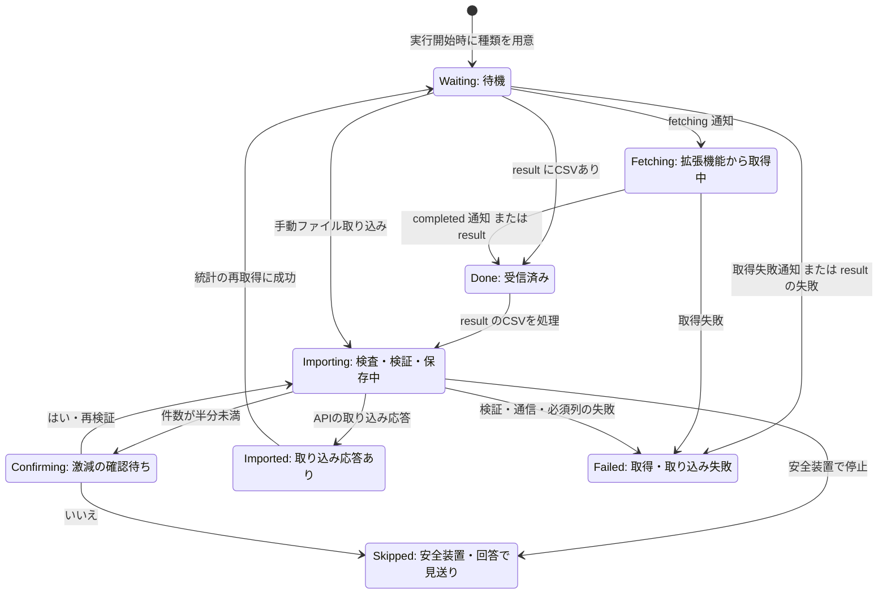
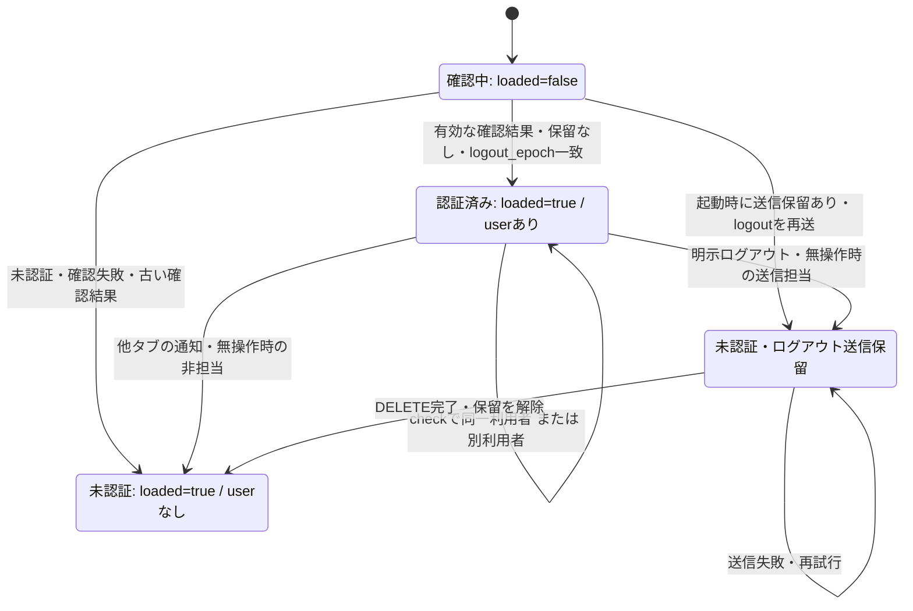
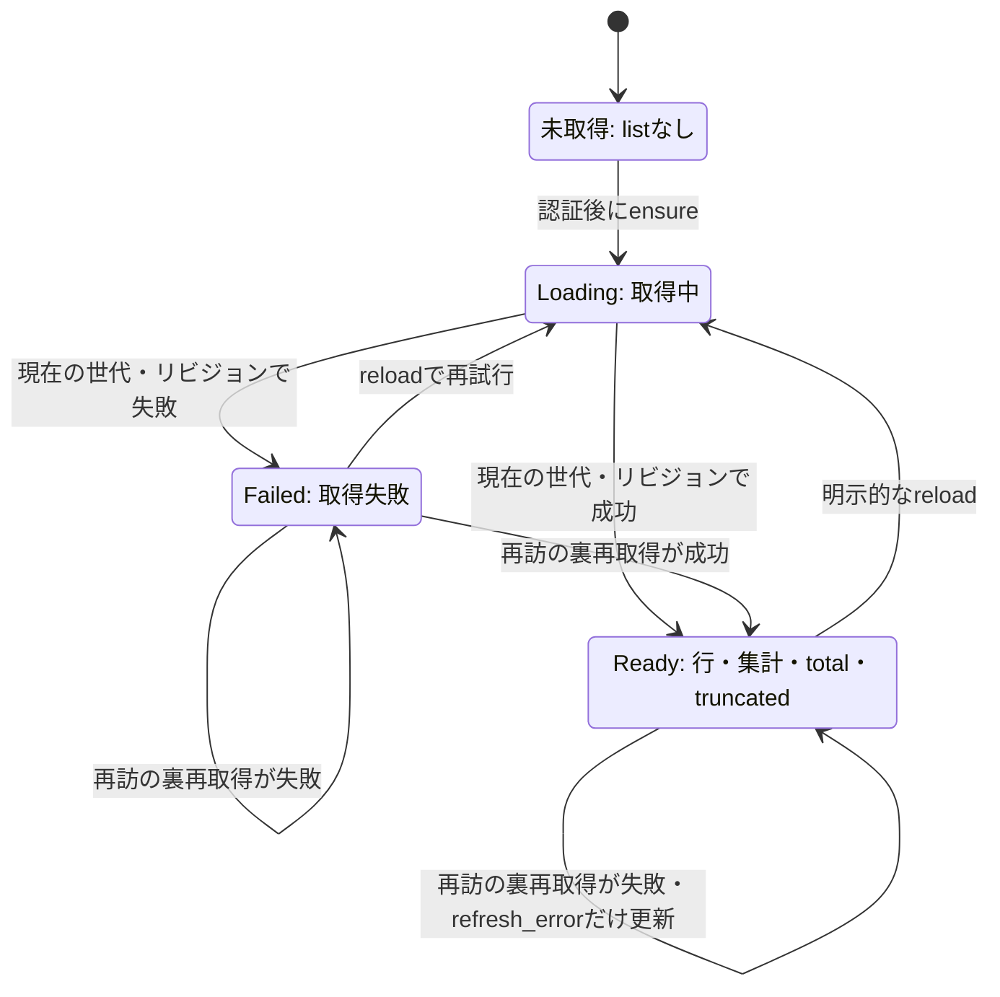
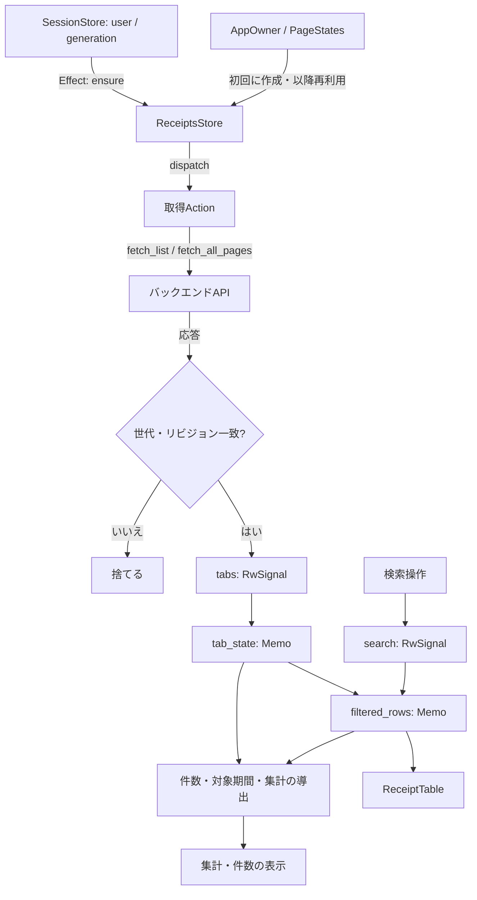

# フロントエンドの状態とデータの流れ

対象: Issue #1601（担当B）。調査基準: `f3a08731` のソースコード。

Signal（信号）は、値を読み書きし、その変更を画面や処理に伝えるLeptosの仕組み。
`RwSignal` は読み書きできる信号、`Memo` は参照した信号から値を導出して共有する仕組み。
`Effect` は参照した信号の変更に応じて処理を実行し、`Action` は非同期の仕事を起動して進行状態を持つ。

## CSV同期の種類別の状態

CSV同期は、拡張機能からの取得とバックエンドへの取り込みをつなぐ処理。
`KindStatus` は5種類それぞれの状態で、実行全体の状態 `SyncState` とは別。

この図で分かること: 取得済みの `Done` と、保存処理が応答した `Imported` の違い。
件数激減の確認は処理途中で止まり、回答後に同じ種類の検証から再開する。

根拠:

- [`frontend/src/features/csv_sync.rs:123`](../../frontend/src/features/csv_sync.rs#L123): `KindStatus` の全状態。
- [`frontend/src/features/csv_sync.rs:180`](../../frontend/src/features/csv_sync.rs#L180)・[`frontend/src/features/csv_sync.rs:219`](../../frontend/src/features/csv_sync.rs#L219): 実行初期化と拡張機能イベントの反映。
- [`frontend/src/features/csv_sync/import.rs:98`](../../frontend/src/features/csv_sync/import.rs#L98)・[`frontend/src/features/csv_sync/import.rs:284`](../../frontend/src/features/csv_sync/import.rs#L284): 自動・手動取り込みの状態更新。
- [`frontend/src/features/csv_sync.rs:414`](../../frontend/src/features/csv_sync.rs#L414)・[`frontend/src/features/csv_sync.rs:433`](../../frontend/src/features/csv_sync.rs#L433): 確認待ちと回答後の再開。
- [`frontend/src/features/csv_sync.rs:388`](../../frontend/src/features/csv_sync.rs#L388)・[`frontend/src/features/csv_page.rs:129`](../../frontend/src/features/csv_page.rs#L129): 取り込み後の統計取得と `Waiting` への移行。

図は1回の処理を中心に示す。手動取り込みは既存の結果がある種類でも開始でき、直接 `Importing` へ進む。
`Imported` の応答には挿入・スキップ件数と行エラーが入るため、必ず全行保存されたという意味ではない。
`Done.lines` は受信本文のレコード数で、バックエンドの有効行数とは別（completed通知だけなら0）。

`SyncState` の主な値は次のとおり（`frontend/src/features/csv_sync.rs:167`）。

| 値 | コード上の意味 |
| --- | --- |
| `running` | 取得・取り込み・確認待ちの間の実行中フラグ。重複開始を抑止する |
| `login_wait` | 拡張機能から `login-wait` 通知を受けた状態。Webアプリ自身のログインとは別 |
| `finished` | result受信、または取り込み終了。これだけでは取り込み完了を意味しない |
| `missing` | 利用できる拡張機能に接続できない |
| `error` | 通信切断または拡張機能全体のエラー |
| `import.confirm` | 件数激減に対する回答待ち |

CSV管理は `finished && !running` を監視して統計を取り直す（`frontend/src/features/csv_page.rs:148`）。
全体の通信エラー・切断・未導入は `running` を解除するが、各 `KindStatus` を一括で `Failed` に変える処理ではない。
ログアウト時の `reset()` は接続を切り、実行番号を進め、表示状態と確認待ちのCSVを捨てる（`frontend/src/features/csv_sync.rs:370`）。

## セッションの状態

セッションは、ログイン済みの利用者を識別する状態。フロントエンドでは `user` と `loaded` の組み合わせで表す。
世代（`Generation`）は利用者の切り替わりを見分ける番号で、古い非同期処理の結果を採用しないために使う。

この図で分かること: 起動時の確認待ち、認証済み、未認証の区別と、ログアウト送信の保留。
通信が失敗しても画面側の認証状態は先に解除される。

根拠:

- [`frontend/src/session.rs:72`](../../frontend/src/session.rs#L72)・[`frontend/src/session.rs:102`](../../frontend/src/session.rs#L102): 初期状態、利用者変更と世代更新。
- [`frontend/src/session.rs:110`](../../frontend/src/session.rs#L110): セッション確認結果と `loaded` の更新、古い応答の除外。
- [`frontend/src/session.rs:149`](../../frontend/src/session.rs#L149)・[`frontend/src/session.rs:215`](../../frontend/src/session.rs#L215): 先に未認証にしてからログアウト送信、起動時の再送。
- [`frontend/src/session/pending_logout.rs:1`](../../frontend/src/session/pending_logout.rs#L1): 保留の保存・解除と再試行処理。
- [`frontend/src/session/idle.rs:49`](../../frontend/src/session/idle.rs#L49)・[`frontend/src/session/cross_tab.rs:46`](../../frontend/src/session/cross_tab.rs#L46): 無操作ログアウトと他タブ通知の受信。

この図の状態名は `SessionStore` の列挙型ではなく、信号と保留記録の組み合わせを説明したもの。
認証済みの利用者が別利用者または未認証に変わると世代が進む。未認証から認証済みになるだけでは進まない。
Googleログインはページ全体を移動し、戻ったページで再び起動時確認を行う（[シーケンス](12-frontend-sequences.md#googleログイン)）。

## 一覧取得の状態（取引明細）

キャッシュは取得済みの値を再利用する保管場所。ここではセッション世代とタブをキーにしたメモリ上の保管で、ブラウザの永続保存とは別。

この図で分かること: 初回取得・明示的な再取得と、再訪時の裏再取得の違い。
裏再取得の失敗では表示済みの `Ready` を残し、別のエラー欄を更新する。

根拠:

- [`frontend/src/features/receipts.rs:139`](../../frontend/src/features/receipts.rs#L139): `TabState` の3状態。
- [`frontend/src/features/receipts/store.rs:15`](../../frontend/src/features/receipts/store.rs#L15)・[`frontend/src/features/receipts/store.rs:130`](../../frontend/src/features/receipts/store.rs#L130): キャッシュ、未取得からの初期化。
- [`frontend/src/features/receipts/store.rs:108`](../../frontend/src/features/receipts/store.rs#L108)・[`frontend/src/features/receipts/store.rs:193`](../../frontend/src/features/receipts/store.rs#L193): 再訪と明示的な再取得。
- [`frontend/src/features/receipts/store.rs:253`](../../frontend/src/features/receipts/store.rs#L253)・[`frontend/src/features/receipts/store.rs:307`](../../frontend/src/features/receipts/store.rs#L307): 成功・失敗の反映、古い応答を捨てる条件。
- [`frontend/src/features/receipts/store.rs:361`](../../frontend/src/features/receipts/store.rs#L361): アクティブなタブが確定後、残りのタブも取得する。

リビジョン（`fetch_rev`）は、同じ世代・同じタブ内で新旧の取得を区別する番号。
古い世代・リビジョンの応答は何も更新せず捨てる。再訪の裏再取得中は新しい列挙状態を作らず `Action.pending()` で実行中を把握する。
資産管理など別機能の状態まで、この図が同じ実装を保証するものではない。

## Signalと画面へのデータの流れ

コンテキストは、親が作った状態を子の画面・処理へ渡す仕組み。
`Owner` はLeptosの状態の寿命を管理する単位で、`AppOwner` はページをまたいで残す状態の親になる。

この図で分かること: 取引明細の取得結果と検索操作が、共通の導出値を通じて表・件数・集計へ届く流れ。
ページを作り直してもストアは `PageStates` に保持される。

根拠:

- [`frontend/src/app.rs:172`](../../frontend/src/app.rs#L172)・[`frontend/src/app.rs:200`](../../frontend/src/app.rs#L200): ページ状態の寿命と遅延生成。
- [`frontend/src/features/receipts/store.rs:279`](../../frontend/src/features/receipts/store.rs#L279): コンテキストのスロットにストアを保持する。
- [`frontend/src/features/receipts/store.rs:307`](../../frontend/src/features/receipts/store.rs#L307)・[`frontend/src/features/receipts/store.rs:361`](../../frontend/src/features/receipts/store.rs#L361): `Action`・`Effect`・結果反映。
- [`frontend/src/features/receipts/view/action_bar.rs:105`](../../frontend/src/features/receipts/view/action_bar.rs#L105): 検索操作からストアへの接続。
- [`frontend/src/features/receipts/view/main_content.rs:43`](../../frontend/src/features/receipts/view/main_content.rs#L43)・[`frontend/src/features/receipts/view/main_content.rs:256`](../../frontend/src/features/receipts/view/main_content.rs#L256): 信号から検索結果・集計・表を導出する。

CSV本文は `SyncState` に載せず、取り込みタスクと確認待ち `pending` に渡す。
CSV同期の実行番号 `epoch` とセッション世代の両方を確認し、無効になった実行の取り込みの後続送信と処理結果の反映を止める（`frontend/src/features/csv_sync.rs:288`・408行、`frontend/src/support/csv_flow.rs:337`）。
`RwSignal::new_local` の `LocalStorage` はLeptosの格納方式を指す型で、ブラウザの `localStorage` に保存するという意味ではない。

## 未確認

- 複数ブラウザ・タブを実際に動かした競合、通信切断の再現結果は未確認。図はコード上のガードと遷移を表す。

## 文書との食い違い

- 担当範囲について既存の全体構成・DB設計・ADRと矛盾する記述は見つからなかった。
