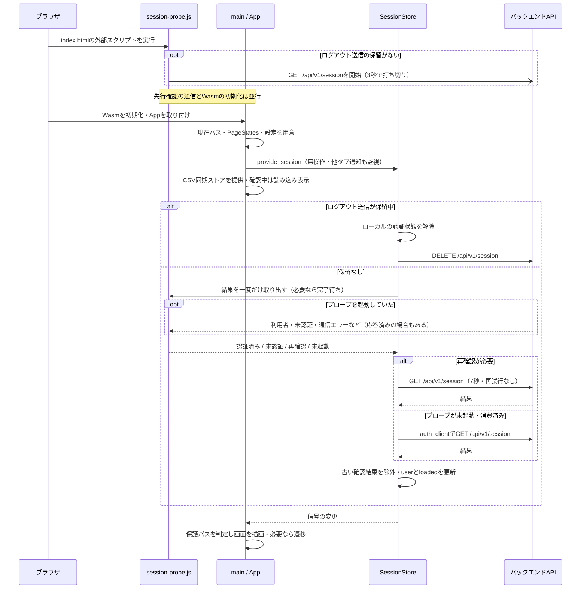
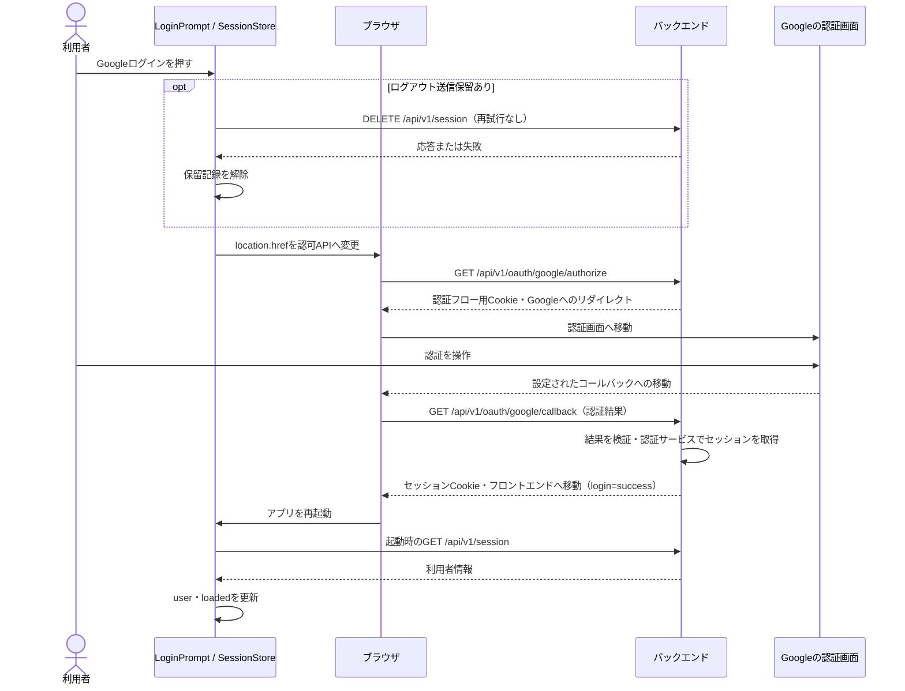
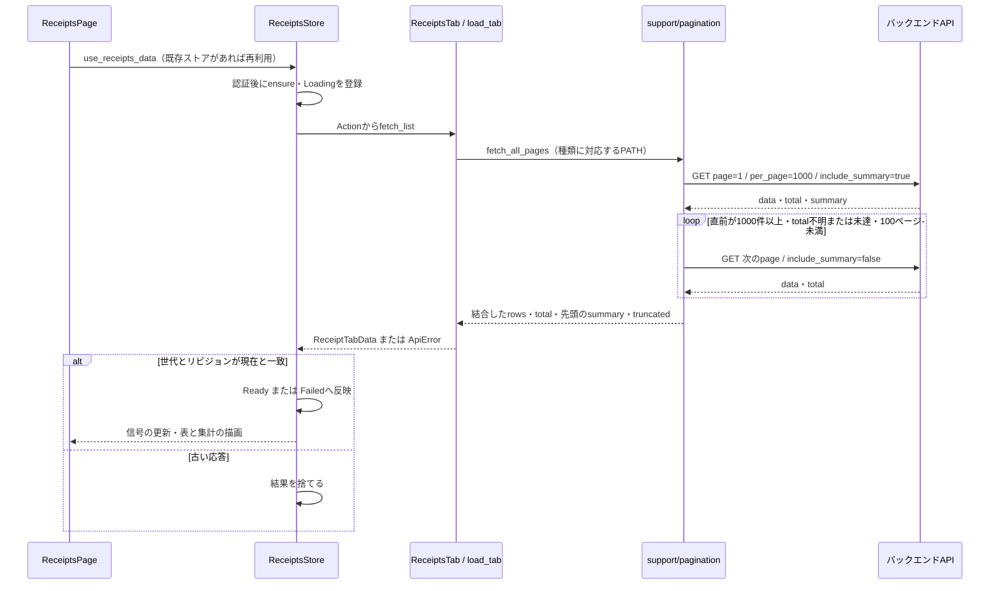
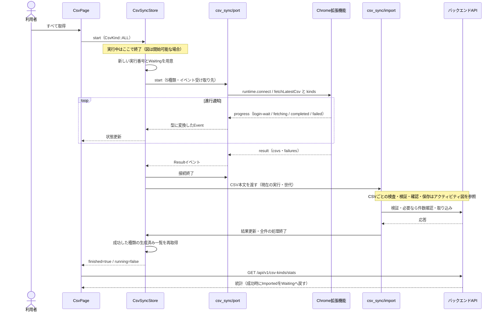
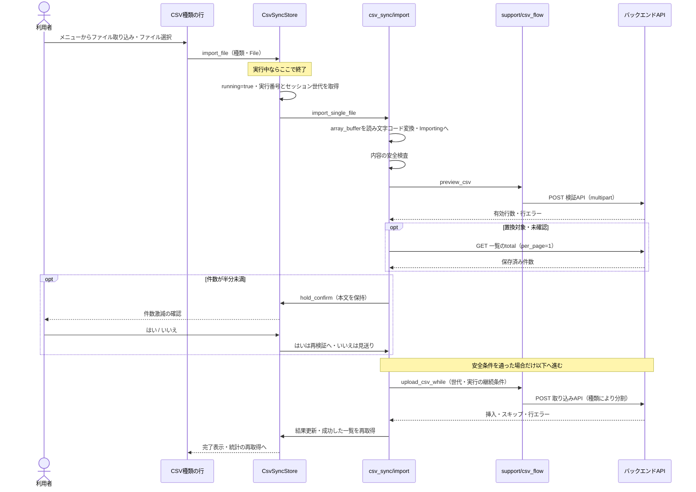

# フロントエンドの処理のシーケンス

対象: Issue #1601（担当B）。調査基準: `f3a08731` のソースコード。

シーケンス図は、登場する画面・処理の間で、上から順に何が渡るかを示す図。
API はバックエンドへの通信窓口。セッションはログイン済みの利用者を識別する状態。
非同期処理は、通信などの完了を待つ間にも別の処理を進められる実行方式。

状態の詳細は [状態とデータの流れ](11-frontend-state.md)、取り込みの停止条件は [CSV取り込みの安全装置](13-frontend-activity.md) を参照。

## アプリの起動

プローブは、本体の準備と並行して先に行う確認処理。このアプリではJavaScriptがセッション確認を先行する。
WasmはブラウザでRustのビルド結果を実行する形式。

この図で分かること: Wasmの起動を待たずに始めたセッション確認を、Leptos側が一度だけ受け取る仕組み。
通信失敗時の再確認と、ログアウト送信が保留中の分岐も示す。

根拠:

- [`frontend/index.html:19`](../../frontend/index.html#L19)・[`frontend/session-probe.js:4`](../../frontend/session-probe.js#L4): 先行確認、保留判定、3秒の打ち切り。
- [`frontend/src/main.rs:13`](../../frontend/src/main.rs#L13)・[`frontend/src/app.rs:247`](../../frontend/src/app.rs#L247): 状態の提供と起動時の組み立て。
- [`frontend/src/session.rs:215`](../../frontend/src/session.rs#L215): 起動時の保留優先とセッション確認。
- [`frontend/src/session/probe.rs:28`](../../frontend/src/session/probe.rs#L28)・[`frontend/src/session.rs:110`](../../frontend/src/session.rs#L110): プローブの取り出し・再確認・結果適用の条件。
- [`frontend/src/app.rs:354`](../../frontend/src/app.rs#L354)・[`frontend/src/app.rs:391`](../../frontend/src/app.rs#L391): 確認完了後の認証ガードと画面表示。

プローブの4xx応答は未認証として再確認しない。5xx・通信失敗・時間切れ・解析失敗などは再確認する。
確認APIの失敗を独立したエラー画面にするのではなく、最終的に利用者なしとして `loaded=true` にする。

## Googleログイン

OAuth は、Googleでの認証結果をアプリのログインにつなぐ仕組み。
Cookie はブラウザがAPIへの通信に付ける情報で、セッション用CookieはJavaScriptから読めない `HttpOnly` 属性を持つ。
リダイレクトは、ブラウザを別のURLへ移動させる応答。

この図で分かること: ログインはSPA内の画面切り替えではなく、Googleとバックエンドを経由するページ全体の移動。
フロントエンドは戻ってからセッションを確認し、認証済み表示へ進む。

根拠:

- [`frontend/src/ui/login_prompt.rs:14`](../../frontend/src/ui/login_prompt.rs#L14): ボタンから `session.login()` を呼ぶ。
- [`frontend/src/session.rs:14`](../../frontend/src/session.rs#L14)・[`frontend/src/session.rs:188`](../../frontend/src/session.rs#L188): 認可先の組み立て、保留解除とページ全体の移動。
- [`backend/src/handlers/v1/auth/oauth.rs:36`](../../backend/src/handlers/v1/auth/oauth.rs#L36)・[`backend/src/handlers/v1/auth/oauth.rs:99`](../../backend/src/handlers/v1/auth/oauth.rs#L99): Cookie属性、認可フロー開始とGoogleへの移動。
- [`backend/src/handlers/v1/auth/oauth.rs:140`](../../backend/src/handlers/v1/auth/oauth.rs#L140): コールバック入力の検証・認証サービス呼び出し・Cookie発行とフロントエンドへの移動。
- [`backend/src/services/auth/google_common.rs:35`](../../backend/src/services/auth/google_common.rs#L35)・[`backend/src/services/auth/google_common.rs:144`](../../backend/src/services/auth/google_common.rs#L144): コールバック先を組み立て、Googleへの認可URLに渡す。
- [`frontend/src/session.rs:110`](../../frontend/src/session.rs#L110): 戻ったページで利用者を確認する。

図は成功時の流れ。コールバック検証が失敗した場合はエラーが返り、成功時の移動には進まない。
認証サービスの内部やDB保存の詳細はバックエンド担当の範囲として省略する。

## 一覧の取得とAPIのページ送り

ページ送りは、一覧APIが返す件数の上限に合わせて、続きのページを順番に取る処理。
ここで示す取引明細は取得したページを結合して表示し、画面の「次へ」を押すたびにAPIを呼ぶ構造ではない。
ストアは画面の状態の保管場所、世代とリビジョンは古い取得を見分ける番号。

この図で分かること: 初回だけ集計を要求し、行を結合してからストアへ結果を返す順序。
遅れて届いた古い取得が新しい表示を上書きしないよう、最後に世代とリビジョンを確認する。

根拠:

- [`frontend/src/features/receipts/store.rs:130`](../../frontend/src/features/receipts/store.rs#L130)・[`frontend/src/features/receipts/store.rs:279`](../../frontend/src/features/receipts/store.rs#L279): 未取得の初期化とストアの再利用。
- [`frontend/src/features/receipts/store.rs:307`](../../frontend/src/features/receipts/store.rs#L307): 取得と応答の採用条件。
- [`frontend/src/features/receipts/kind.rs:919`](../../frontend/src/features/receipts/kind.rs#L919): 種類別取得と `ReceiptTabData` への変換。
- [`frontend/src/support/pagination.rs:8`](../../frontend/src/support/pagination.rs#L8)・[`frontend/src/support/pagination.rs:49`](../../frontend/src/support/pagination.rs#L49)・[`frontend/src/support/pagination.rs:85`](../../frontend/src/support/pagination.rs#L85): 上限・クエリ・ページ結合と終了条件。
- [`frontend/src/features/receipts/view/main_content.rs:54`](../../frontend/src/features/receipts/view/main_content.rs#L54): 取得結果を使う画面の導出値。

取得途中のAPI失敗は結合済みの一部を成功結果として返さず、エラーで終わる。
APIの `total` は非負の値だけを採用し、それまで有効な値がなければ不明として扱う。上限到達時も続きを見込む場合に `truncated=true` を返す。
再訪時は既存表示を残して裏で取得し、失敗を `refresh_error` に出す（[状態図](11-frontend-state.md#一覧取得の状態取引明細)）。

## CSV管理の「すべて取得」

ポートは `chrome.runtime.connect` で作る、WebアプリとChrome拡張機能の継続的な通信路。
CSVは表形式のテキストファイルで、ここでは5種類を1回の依頼に含める。

この図で分かること: Webアプリが拡張機能へ依頼し、進行通知と最終結果を受けてから取り込みへ進む順序。
拡張機能内部の証券サイト操作はフロントエンドのコードからは確認できないため描かない。

根拠:

- [`frontend/src/features/csv_page.rs:182`](../../frontend/src/features/csv_page.rs#L182)・[`frontend/src/features/csv_sync.rs:28`](../../frontend/src/features/csv_sync.rs#L28): ボタンと5種類の依頼。
- [`frontend/src/features/csv_sync.rs:350`](../../frontend/src/features/csv_sync.rs#L350): 重複開始の抑止、実行番号の更新、イベント受付条件。
- [`frontend/src/features/csv_sync/port.rs:113`](../../frontend/src/features/csv_sync/port.rs#L113)・[`frontend/src/features/csv_sync/port.rs:173`](../../frontend/src/features/csv_sync/port.rs#L173)・[`frontend/src/features/csv_sync/port.rs:230`](../../frontend/src/features/csv_sync/port.rs#L230): 接続・依頼メッセージ・受信型の変換。
- [`frontend/src/features/csv_sync.rs:465`](../../frontend/src/features/csv_sync.rs#L465)・[`frontend/src/features/csv_sync.rs:500`](../../frontend/src/features/csv_sync.rs#L500): 一覧の再取得・ポート終了・取り込み起動。
- [`frontend/src/features/csv_sync/import.rs:98`](../../frontend/src/features/csv_sync/import.rs#L98): 受信したCSVを順に処理し、確認待ちでは残りを保留する。
- [`frontend/src/features/csv_page.rs:129`](../../frontend/src/features/csv_page.rs#L129)・[`frontend/src/api.rs:13`](../../frontend/src/api.rs#L13): 完了後の統計取得。

図はCSVを受信できた経路。`chrome.runtime.connect` のない環境、接続不可、結果前の切断、拡張機能の `error` 応答では取り込みに進まない。
接続候補は順に試し、1通も届かず切断された場合だけ次の候補へ進む（`frontend/src/features/csv_sync/port.rs:146`・204行）。
結果に失敗した種類が含まれても、受け取れたCSVは処理する。CSVの処理順は受信した配列の順であり、フロントエンドで種類順に並べ直してはいない。
CSV本文は表示用の状態に含めず、タスクと件数激減の確認待ちだけで保持する。

## 手動のファイル取り込み

multipartは、ファイルをフォームの一部としてAPIへ送る形式。
文字コードは文字とバイトの対応規則で、ここではUTF-8を試し、必要に応じてShift-JISとして読む。

この図で分かること: 行のメニューで選んだファイルが、自動取得と共通の安全装置に入る流れ。
確認が必要なときは、本文と残りの処理を保持して回答を待つ。

根拠:

- [`frontend/src/ui/csv_page.rs:382`](../../frontend/src/ui/csv_page.rs#L382): ファイル選択・種類に対応した `import_file` 呼び出し。
- [`frontend/src/features/csv_sync.rs:336`](../../frontend/src/features/csv_sync.rs#L336): 実行中判定・手動取り込みの起動。
- [`frontend/src/features/csv_sync/import.rs:183`](../../frontend/src/features/csv_sync/import.rs#L183)・[`frontend/src/features/csv_sync/import.rs:284`](../../frontend/src/features/csv_sync/import.rs#L284): 共通安全装置と手動取り込み本体。
- [`frontend/src/features/csv_sync/import.rs:339`](../../frontend/src/features/csv_sync/import.rs#L339)・[`frontend/src/support/csv_flow.rs:168`](../../frontend/src/support/csv_flow.rs#L168): ファイル読み込みと文字コード判定。
- [`frontend/src/features/csv_sync.rs:414`](../../frontend/src/features/csv_sync.rs#L414)・[`frontend/src/features/csv_sync.rs:433`](../../frontend/src/features/csv_sync.rs#L433): 確認待ちと回答後の再処理。
- [`frontend/src/support/csv_flow.rs:302`](../../frontend/src/support/csv_flow.rs#L302)・[`frontend/src/support/csv_flow.rs:337`](../../frontend/src/support/csv_flow.rs#L337): 検証・取り込み送信と継続条件。

途中の停止・失敗・古い応答の扱いは [安全装置の図](13-frontend-activity.md) を参照。
明細の分割送信では、後続が失敗しても先に送信した分まで自動で元に戻す処理はない。

## 未確認

- 実際のGoogle認証画面とChrome拡張機能内部の動作は未確認。図はWebアプリ側の呼び出し・受信契約とバックエンドの境界処理を表す。
- 本番での通信時間・同時実行・ブラウザ間の差は測定していない。

## 文書との食い違い

- `docs/architecture.md` の「認証フロー」と「CSVインポート設計」に矛盾する処理は見つからなかった。ここでは先行確認・手動/拡張機能入力・分割送信を補足した。
