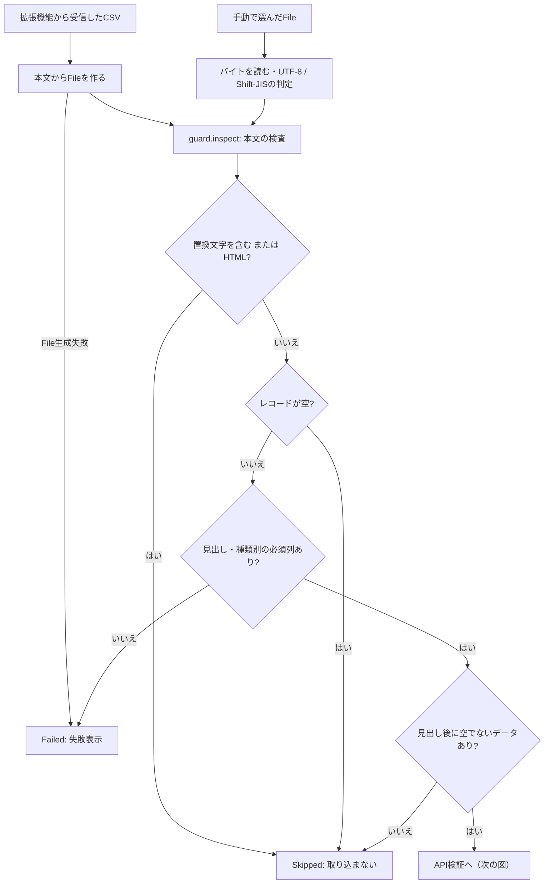
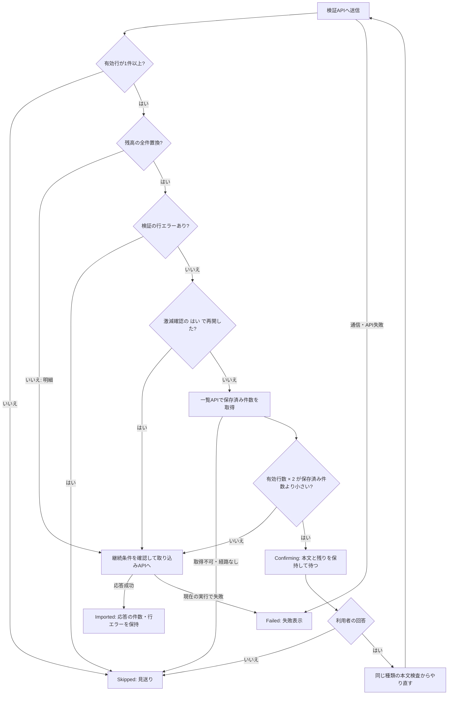

# CSV取り込みの安全装置

対象: Issue #1601（担当B）。調査基準: `f3a08731` のソースコード。

| 用語 | 意味 |
| --- | --- |
| アクティビティ図 | アクティビティ図は、処理の順序と条件による分岐を表す図。 |
| CSV・API | CSVは表形式のテキスト、APIはバックエンドとの通信窓口。 |
| HTML | HTMLはWebページを記述する形式で、ログイン画面やエラーページをCSVと取り違えないために検査する。 |
| 検証・取り込み | 検証（preview）は保存前に有効行とエラーを調べる処理、取り込み（import）は保存を依頼する処理。 |
| 全件置換 | 全件置換は、その種類の保存済み残高を新しいCSVの内容で入れ替える保存方式。 |

ここではGitHubで表示できる `flowchart` を使う。

## 入り口と本文の検査

この図で分かること: 拡張機能からの取得結果と手動ファイルが、同じ本文の検査へ入る流れ。
空・HTML・文字化けは見送り、必要な列がない場合は失敗表示にする。

根拠:

- [`frontend/src/features/csv_sync/import.rs:160`](../../frontend/src/features/csv_sync/import.rs#L160)・[`frontend/src/features/csv_sync/import.rs:246`](../../frontend/src/features/csv_sync/import.rs#L246): 受信本文のFile化と共通処理への受け渡し。
- [`frontend/src/features/csv_sync/import.rs:284`](../../frontend/src/features/csv_sync/import.rs#L284)・[`frontend/src/features/csv_sync/import.rs:339`](../../frontend/src/features/csv_sync/import.rs#L339): 手動ファイルの読み込みと共通処理。
- [`frontend/src/features/csv_sync/guard.rs:17`](../../frontend/src/features/csv_sync/guard.rs#L17)・[`frontend/src/features/csv_sync/guard.rs:47`](../../frontend/src/features/csv_sync/guard.rs#L47): 種類別の必須列、文字化け・HTML・空・見出し・データの検査。
- [`frontend/src/features/csv_sync/import.rs:192`](../../frontend/src/features/csv_sync/import.rs#L192): 必須列なしを `Failed`、その他の検査理由を `Skipped` に変換する。
- [`frontend/src/support/csv_flow.rs:97`](../../frontend/src/support/csv_flow.rs#L97)・[`frontend/src/support/csv_flow.rs:168`](../../frontend/src/support/csv_flow.rs#L168): 引用符内の改行を区切らないレコード検出と文字コード判定。

見出しに目印がある種類では先頭10レコード以内を探し、目印なしの取引履歴では先頭レコードを使う。
必須列は列名の前方一致で判定する。これは種類を見分けるための事前検査で、API側の全行の検証に代わるものではない。
手動ファイルの読み込みに失敗した場合、現実装は空文字列として検査へ渡す（`frontend/src/features/csv_sync/import.rs:295`）。

## API検証から確認・取り込みまで

世代は利用者の切り替わりを、実行番号はCSV同期のリセットや次回実行を区別する値。
確認の再開時も本文の検査とAPI検証を行い、保存済み件数との比較だけを省く。

この図で分かること: 検証結果だけで保存に進める場合と、残高の全件置換を止める条件。
件数が半分未満になるときは回答を待ち、確認できない場合は取り込まない。

根拠:

- [`frontend/src/features/csv_sync/import.rs:32`](../../frontend/src/features/csv_sync/import.rs#L32): 残高2種類が全件置換、明細3種類が追記の計画。
- [`frontend/src/features/csv_sync/import.rs:183`](../../frontend/src/features/csv_sync/import.rs#L183): 本文検査・API検証・有効行判定・行エラー停止・件数比較・取り込み。
- [`frontend/src/features/csv_sync/guard.rs:117`](../../frontend/src/features/csv_sync/guard.rs#L117): 激減判定は `new_rows * 2 < saved_rows`（半分と等しければ確認しない）。
- [`frontend/src/features/csv_sync/import.rs:347`](../../frontend/src/features/csv_sync/import.rs#L347): 一覧の `total` を `page=1`・`per_page=1`・集計なしで取得する。
- [`frontend/src/features/csv_sync.rs:408`](../../frontend/src/features/csv_sync.rs#L408)・[`frontend/src/features/csv_sync.rs:433`](../../frontend/src/features/csv_sync.rs#L433): 実行の有効性と確認回答の処理。
- [`frontend/src/features/csv_sync/import.rs:98`](../../frontend/src/features/csv_sync/import.rs#L98): 確認待ちで残りを保持し、各種類の結果を更新する。
- [`frontend/src/support/csv_flow.rs:337`](../../frontend/src/support/csv_flow.rs#L337): 取り込み開始・分割後・各分割送信前に継続条件を確認する。

すべての分岐に共通する扱い:

- 自動取り込みの各種類の開始時、取り込み結果の反映時、確認表示・回答時に実行番号とセッション世代を照合する。無効ならその処理を終える。
- 検証後と、件数確認を通過したあとにも照合し、取り込み送信は `upload_csv_while` の継続条件で止める。送信済みのHTTPリクエストを取り消す保証ではない。
- スキップ・失敗した種類のあとも、受信済みの残りがあれば処理する。確認待ちだけは全体を止め、回答後に続ける。
- 保存後は生成済みの明細・残高ストアのうち取り込めた種類を再取得する。未訪問のページ状態をこのためだけに新しく作らない（`frontend/src/features/csv_sync.rs:476`）。

## 種類ごとの送信方式

分割送信は、大きいCSVを複数のリクエストに分ける処理。全件置換の取り込みを分割すると、後の送信が前の結果を消すため分割しない。

| CSVの種類 | 保存方式 | 検証の分割 | 取り込みの分割 |
| --- | --- | --- | --- |
| 国内株式の保有残高 | 全件置換 | しない（口座区切りの文脈を保つ） | しない |
| 投資信託の保有残高 | 全件置換 | する | しない |
| 配当・国内株式の取引・投資信託の取引 | 追記 | する | する |

根拠: [`frontend/src/features/asset_balance/csv.rs:13`](../../frontend/src/features/asset_balance/csv.rs#L13)・[`frontend/src/features/asset_balance/fund.rs:17`](../../frontend/src/features/asset_balance/fund.rs#L17)・[`frontend/src/features/receipts/csv.rs:5`](../../frontend/src/features/receipts/csv.rs#L5)。

分割の基準は500データ行。ただし同じバイト列のレコード群が分割境界をまたがないよう後方へ伸ばすため、500行は厳密な上限ではない。
検証・取り込みの結果は件数と行エラーの位置を補正して結合する（`frontend/src/support/csv_flow.rs:70`・137行・302行・337行）。
複数リクエストをまたいだ一括取り消しは実装されていない。後続が失敗した場合、先に成功した取り込みまで未実行として扱えるわけではない。

## 未確認

- 本番CSVや実際の拡張機能で検査を実行していない。入力例・実データ・識別子は記載していない。
- バックエンド内部の置換・重複判定・トランザクションの詳細はこの担当範囲の図には含めていない。

## 文書との食い違い

- [architecture.md](../architecture.md) の検証→取り込みの2段階、[db-design.md](../db-design.md) の明細は追記・残高は上書き、という区分と一致する。
