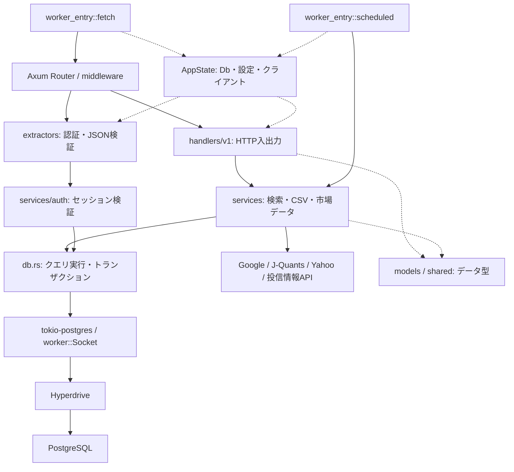
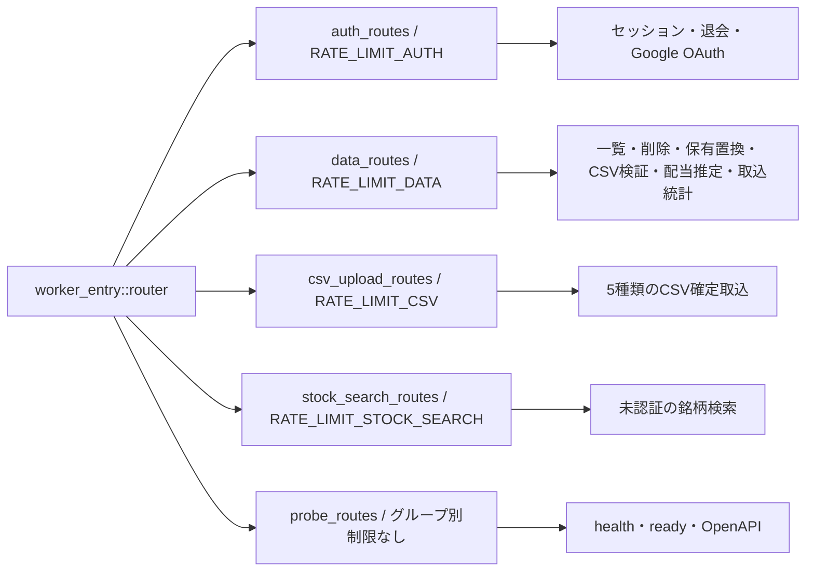

# バックエンドの層構造とルート

担当Cの現行コードの読み取り結果。全体の境界は [architecture.md](../architecture.md)、データの意味は [db-design.md](../db-design.md)、設計判断は [ADR 0001](../adr/0001-keep-axum-and-harden-api.md)・[ADR 0002](../adr/0002-separate-stock-master-and-caches.md) を参照する。
[Pages移行メモ](cloudflare-pages.md)・[Workers移行メモ](cloudflare-workers-backend.md) は移行当時の検討記録であり、本資料では移行手順・費用を繰り返さない。

## 層と責務

| 用語 | 意味 |
| --- | --- |
| HTTP・API | HTTP はブラウザとサーバーが要求・応答をやりとりする通信方式、API はプログラムから処理を呼ぶ窓口。 |
| DB・SQL・JSON | DB はデータベース、SQL はDBへの検索・更新の命令、JSON は項目名と値を組にしたデータ形式。 |
| Worker・Axum | Worker は Cloudflare 上でイベントを受けて動く実行単位。Axum は HTTP の行き先と入出力を扱う Rust のライブラリ。 |
| handler・service・extractor | handler は HTTP の入力を受けて応答を作る関数、service は業務処理と SQL を持つ関数群、extractor は handler の実行前に入力の取り出しや検証を行う部品。 |
| model・middleware・Hyperdrive | model は入力・出力・DB行などのデータ型、middleware は複数のルートに共通する前後処理。Hyperdrive は Worker の DB 接続を仲介する仕組み。 |

この図で分かること: HTTP と定期実行の入口がどこで分かれ、どの部品が業務処理・DB接続・データ型を担当するか。実線は呼び出し、点線は設定・型の利用を示す（主要な関係のみ）。

根拠:

- `backend/src/worker_entry.rs:49`（Routerの組み立て）、`backend/src/worker_entry.rs:123`（AppState構築）、`backend/src/worker_entry.rs:167`（fetch）、`backend/src/worker_entry.rs:199`（scheduled）。
- `backend/src/extractors/auth.rs:20`、`backend/src/extractors/validated_json.rs:14`（入力の検証）。
- `backend/src/handlers/v1/dividends.rs:47`、`backend/src/handlers/v1/csv_import.rs:52`（serviceへの委譲）。
- `backend/src/services/domain/search.rs:168`、`backend/src/services/auth.rs:119`（service内のSQL）。
- `backend/src/state.rs:45`、`backend/src/models/common.rs:4`（状態・共有型）。
- `backend/src/db.rs:454`、`backend/src/db.rs:472`（HyperdriveとSocket）、`backend/src/services/auth/google_worker.rs:15`、`backend/src/services/stock_price.rs:292`、`backend/src/services/fund_price.rs:374`、`backend/src/services/dividend_cache/persistence.rs:21`（外部通信）。

トランザクションは、複数のDB操作をまとめて確定または取り消す単位。`AppState.pool` の型は `Db` で、Workerでは最初のクエリ時に接続し、同一リクエスト内の通常クエリで共有する。トランザクション用は別接続を使う（`backend/src/db.rs:499`・`backend/src/db.rs:512`）。

この図は必ず全層を順に通るという意味ではない。たとえば認証 extractor は認証serviceを直接呼び、`/ready` は入口からDBへ直接問い合わせる。Repository（DB操作専用の抽象インターフェース）は設けず、SQLはservice内にある。

## ルートの振り分け

| 用語 | 意味 |
| --- | --- |
| ルート・レート制限 | ルートは HTTP のメソッドとパスの組み合わせ。レート制限は一定時間内の呼び出し数を制限する仕組みで、認証の有無とは別に設定される。 |
| binding | binding は、レート制限などの外部機能をWorkerから名前で参照するための設定。 |

この図で分かること: HTTPルートをどのグループへ振り分け、どのレート制限を付けるか。完全なメソッドとパスは下表に示す。

根拠:

- `backend/src/worker_entry.rs:29`（binding未設定なら制限を付けない）、`backend/src/worker_entry.rs:55`（4グループへの制限）、`backend/src/worker_entry.rs:78`（probe）、`backend/src/worker_entry.rs:100`（結合と共通middleware）。
- `backend/src/handlers/v1.rs:19`（auth）、`backend/src/handlers/v1.rs:41`（data）、`backend/src/handlers/v1.rs:96`（stock_search）、`backend/src/handlers/v1.rs:101`（csv_upload）。

表のパスは、probe以外すべて `/api/v1` を先頭に付ける。OpenAPI は API の入出力を機械可読形式で記した契約で、正本は [openapi.json](../openapi.json)。

| グループ | メソッド | パス | 処理 |
| --- | --- | --- | --- |
| auth | GET / DELETE | `/session` | セッション取得 / ログアウト |
| auth | POST | `/account-deletion-confirmations` | 退会確認 |
| auth | DELETE | `/account` | 退会 |
| auth | GET | `/oauth/google/authorize` | Google認証開始 |
| auth | GET | `/oauth/google/callback` | Google認証結果受付 |
| data | GET / DELETE | `/dividends` | 配当一覧 / 全削除 |
| data | GET / DELETE | `/domestic-stock-transactions` | 国内株式取引一覧 / 全削除 |
| data | GET / DELETE | `/mutual-fund-transactions` | 投資信託取引一覧 / 全削除 |
| data | GET / PUT / DELETE | `/asset-balances` | 国内株式保有一覧 / 置換 / 全削除 |
| data | GET / DELETE | `/fund-balances` | 投資信託保有一覧 / 全削除 |
| data | POST | `/dividend-import-validations` | 配当CSV検証 |
| data | POST | `/domestic-stock-import-validations` | 国内株式取引CSV検証 |
| data | POST | `/mutual-fund-import-validations` | 投資信託取引CSV検証 |
| data | POST | `/asset-balance-import-validations` | 国内株式保有CSV検証 |
| data | POST | `/fund-balance-import-validations` | 投資信託保有CSV検証 |
| data | POST | `/dividend-per-share-estimates` | 配当キャッシュ読取・更新予約 |
| data | GET | `/csv-kinds/stats` | CSV種別の件数・取込日時 |
| csv | POST | `/dividend-imports` | 配当CSV取込 |
| csv | POST | `/domestic-stock-imports` | 国内株式取引CSV取込 |
| csv | POST | `/mutual-fund-imports` | 投資信託取引CSV取込 |
| csv | POST | `/asset-balance-imports` | 国内株式保有CSV取込 |
| csv | POST | `/fund-balance-imports` | 投資信託保有CSV取込 |
| stock_search | GET | `/stocks` | 銘柄検索 |
| probe | GET | `/health` | 固定のOK応答 |
| probe | GET | `/ready` | DBへ `SELECT 1`、成功200 / 失敗503 |
| probe | GET | `/api-docs/openapi.json` | チェックイン済み契約ファイル |

## 未確認

- デプロイ済み環境のbinding・秘密値・DB接続先の実設定は確認していない。図はコードの接続経路までを示す。
- 実際の呼び出し数・遅延・同時実行数は計測していない。

## 文書との食い違い

- 移行メモ中の Fly.io・Neon・sqlx 等は冒頭で過去の記録と明示されているため、現行図へ転記しない。
- ADR 0001 の Context / Consequences には SQLx・Fly.io の記述が残る。一方、同ADRの Architecture Stance と現行コードはservice内の tokio-postgres 利用を示す（`backend/src/db.rs:15`・`backend/src/db.rs:472`）。過去の記述をこのPRでは更新しない。
