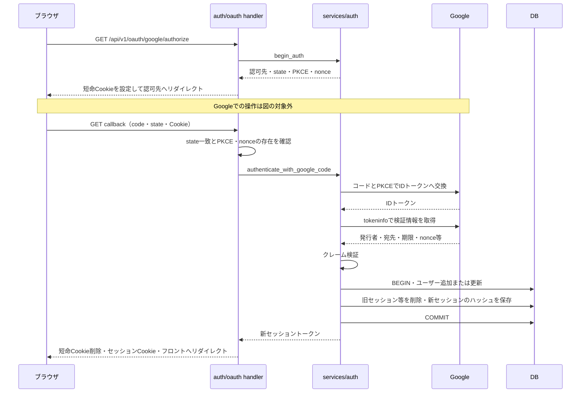
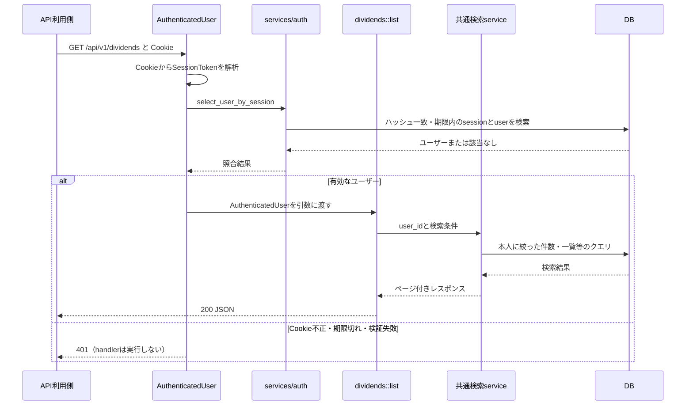
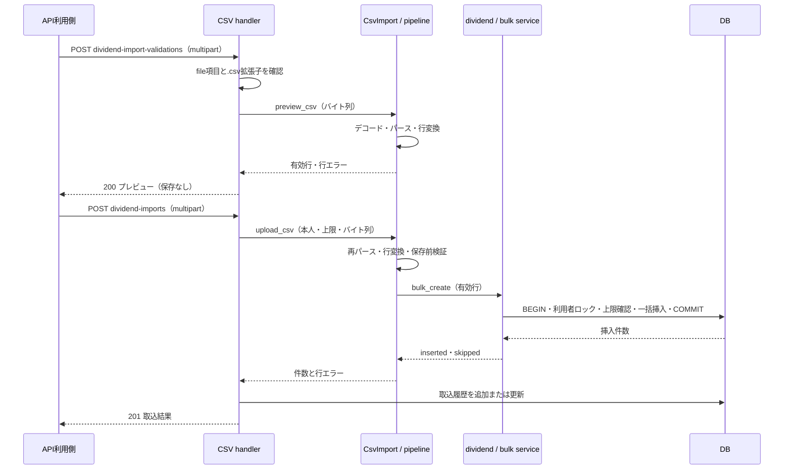
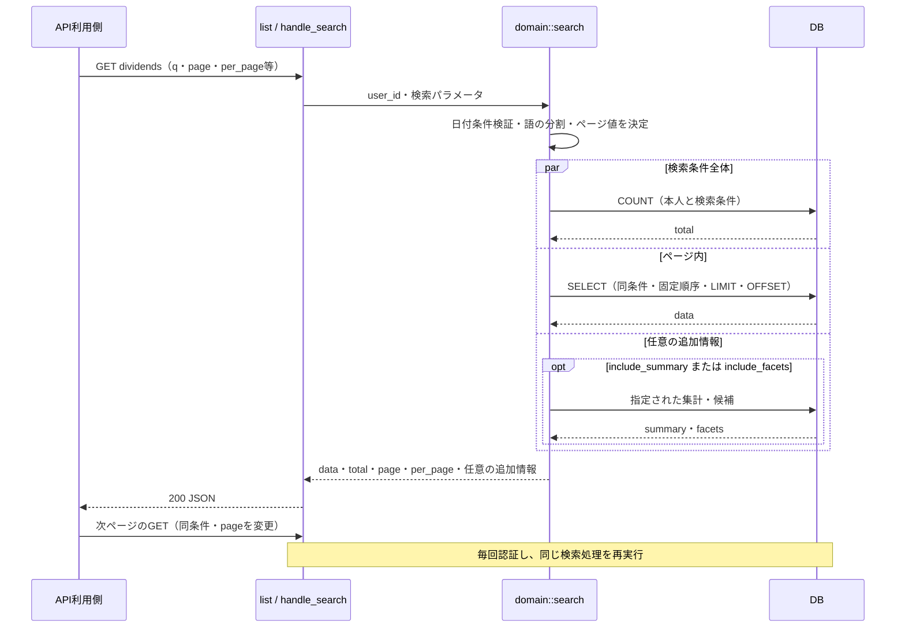

# バックエンドのシーケンス

シーケンス図は、部品間の呼び出しと応答を上から下へ時系列で示す図。本資料はバックエンド側で追える処理を示し、ブラウザの実画面操作やGoogle側の内部処理は扱わない。
入口・共通middlewareは [層構造とルート](20-backend-structure.md)、分岐の詳細は [アクティビティ](22-backend-activity.md) を参照する。

## Google OAuth とセッション作成

| 用語 | 意味 |
| --- | --- |
| OAuth | OAuth は外部サービスでの認証結果を受け取る仕組み。 |
| Cookie・セッション | Cookie はブラウザが保存し、リクエスト時に送り返す値で、セッションはログイン状態をDBと照合する仕組み。 |
| state・PKCE・nonce | state は認証開始と結果を結び付ける値、PKCE は認可コードを盗まれても交換されにくくする検証方式、nonce は受け取るIDトークンを今回の認証に結び付ける値。 |

この図で分かること: 認証開始で短命Cookieを作り、callbackで照合してからGoogleへのコード交換とDB保存へ進む順序。正常に最後まで進む経路を示す。

根拠:

- `backend/src/handlers/v1/auth/oauth.rs:99`（開始）、`backend/src/handlers/v1/auth/oauth.rs:140`（callbackの照合とCookie操作）。
- `backend/src/services/auth/google_common.rs:62`（認証開始用の値生成）、`backend/src/services/auth/google_common.rs:183`（クレーム検証）。
- `backend/src/services/auth/google_worker.rs:15`（交換）、`backend/src/services/auth/google_worker.rs:63`（tokeninfo）、`backend/src/services/auth/google_worker.rs:82`（呼出順序）。
- `backend/src/services/auth.rs:61`（認証）、`backend/src/services/auth.rs:107`（トランザクション）、`backend/src/services/auth.rs:153`（旧削除と新発行）、`backend/src/services/auth.rs:174`（ユーザー更新）。

| 用語 | 意味 |
| --- | --- |
| クレーム・検証 | クレームはIDトークンの発行者・宛先・期限などの属性。検証は `iss`・`aud`・`exp`・`nonce` と `sub`・`email` の存在を確認する。 |
| ハッシュ・セッション | ハッシュは元の値をそのまま保存せず照合に使う変換値で、セッションは SHA-256 のハッシュをDBに保存する（`backend/src/services/auth.rs:29`）。 |
| 短命Cookie・セッションCookie・HttpOnly | 短命Cookieは10分、セッションCookieは7日。どちらも `HttpOnly`（JavaScriptから読み取れない属性）を持ち、`secure_cookie` の値で `Secure`・`SameSite` を決める（`backend/src/handlers/v1/auth/oauth.rs:36`・`backend/src/handlers/v1/auth/oauth.rs:51`・`backend/src/handlers/v1/auth/oauth.rs:67`）。 |

state不一致や必須Cookie欠落は後続に進まず、Google検証失敗時はユーザー・セッションを作らない。図中のDB操作は一つのトランザクションである。

## 認証付きAPIの1リクエスト

この図で分かること: 配当一覧を例に、Cookieの認証が成功してから本人のデータを検索する順序。共通middlewareを通過した後を描く。

根拠:

- `backend/src/extractors/auth.rs:20`（Cookie解析・検証・拒否）、`backend/src/services/auth.rs:119`（期限とハッシュの照合）。
- `backend/src/handlers/v1/dividends.rs:47`、`backend/src/handlers/common.rs:17`（共通検索への引数）。
- `backend/src/services/domain/search.rs:63`・`backend/src/services/domain/search.rs:168`、`backend/src/services/domain/search_filters.rs:199`（本人と検索条件による絞り込み）。

Cookie欠落・不正はDB照会より前に401になる。extractor内のDBエラーも401へ変換されるため、図の失敗側はDBに到達しない場合も含む。

## CSV取込の2リクエスト

CSV は表をカンマ区切りのテキストにした形式。multipart はファイルと項目を一緒に送るHTTPの形式。

この図で分かること: プレビューと確定取込は別リクエストで、確定時にもファイルを読み直すこと。両方とも認証を通過した配当CSVの正常系を示す。

根拠:

- `backend/src/handlers/v1/dividends.rs:94`（検証）、`backend/src/handlers/v1/dividends.rs:114`（取込）、`backend/src/handlers/v1/csv_import.rs:12`・`backend/src/handlers/v1/csv_import.rs:34`・`backend/src/handlers/v1/csv_import.rs:52`（共通処理）。
- `backend/src/services/csv/pipeline.rs:31`、`backend/src/services/csv/import.rs:48`・`backend/src/services/csv/import.rs:62`（パースと変換）。
- `backend/src/services/dividend.rs:115`、`backend/src/services/domain/bulk.rs:162`・`backend/src/services/domain/bulk.rs:176`（追記）、`backend/src/services/csv.rs:11`（履歴）。

配当CSVは有効行を追記し重複をスキップする。全行エラーで挿入・スキップとも0なら履歴更新を省略する。保有CSVの全置換と拒否条件は [アクティビティ](22-backend-activity.md) を参照。
履歴更新は取込のCOMMIT後に行う別操作であり、全体を一つのトランザクションとは描いていない。

## 一覧の検索とページ送り

| 用語 | 意味 |
| --- | --- |
| ページ送り・LIMIT・OFFSET | ページ送りは結果を指定件数ずつ取り出すこと。`LIMIT` は取得件数、`OFFSET` は先頭から読み飛ばす件数。 |
| summary・facets | summary は検索全体の集計、facets は絞り込み候補を表す。 |

この図で分かること: 同じ検索条件で件数とページ内の行を取得し、次ページは新しいGETとして処理すること。配当一覧の認証後を例とする。

根拠:

- `backend/src/handlers/v1/dividends.rs:47`、`backend/src/handlers/common.rs:17`（入口）。
- `backend/src/services/domain/search.rs:46`・`backend/src/services/domain/search.rs:157`（検証・並行取得・レスポンス）。
- `backend/src/services/domain/search_filters.rs:166`・`backend/src/services/domain/search_filters.rs:199`（語の分割・条件）、`backend/src/services/dividend.rs:69`（決済日降順・ID降順）。
- `shared/src/common.rs:28`（ページ値）、`shared/src/common.rs:86`（集計・候補は既定false）、`shared/src/common.rs:155`（応答型）。

pageは既定1・下限1、per_pageは既定200・1〜1000に収める。OFFSETは `(page - 1) * per_page`。語の間はAND、1語の検索対象列の間はORで絞る。集計と候補にはページのLIMITをかけない。

## 未確認

- Googleの同意画面の内部処理、実際のCookieの送受信、デプロイ済み環境での一連の通信は実行していない。
- 同時にデータが増減した場合に、別クエリの件数・一覧が同一時点の状態になることは保証として確認していない。

## 文書との食い違い

- [architecture.md](../architecture.md) のCSV概要は4種類を例示する。現行ルートには投資信託保有の検証・取込もあるため、本資料のルート一覧では5種類を示す（`backend/src/handlers/v1.rs:85`・`backend/src/handlers/v1.rs:113`）。
