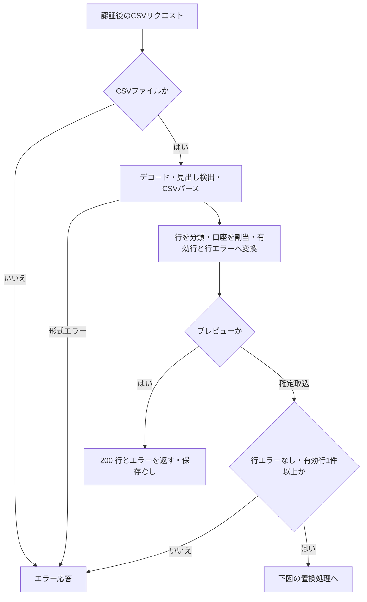
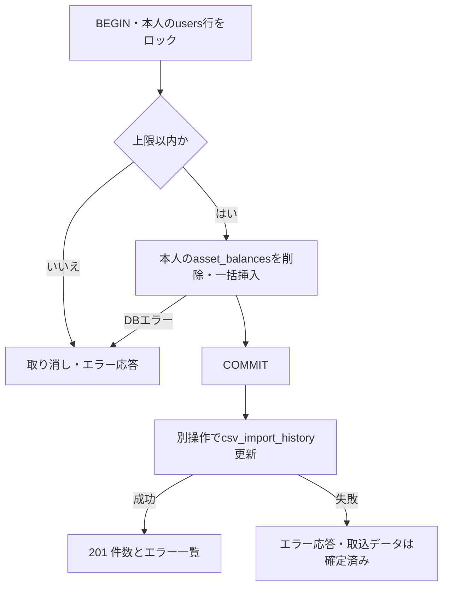
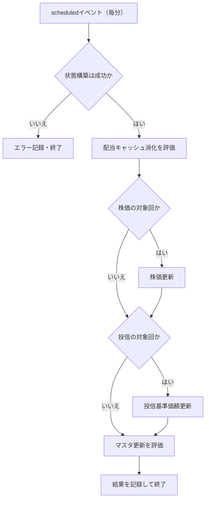
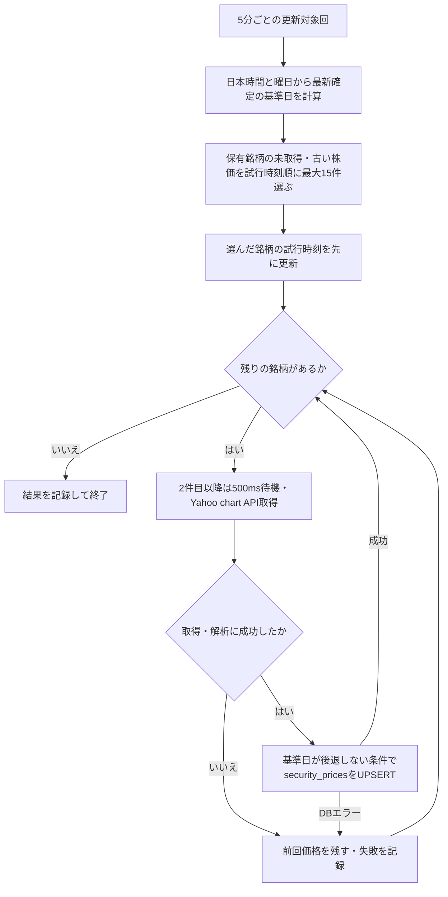
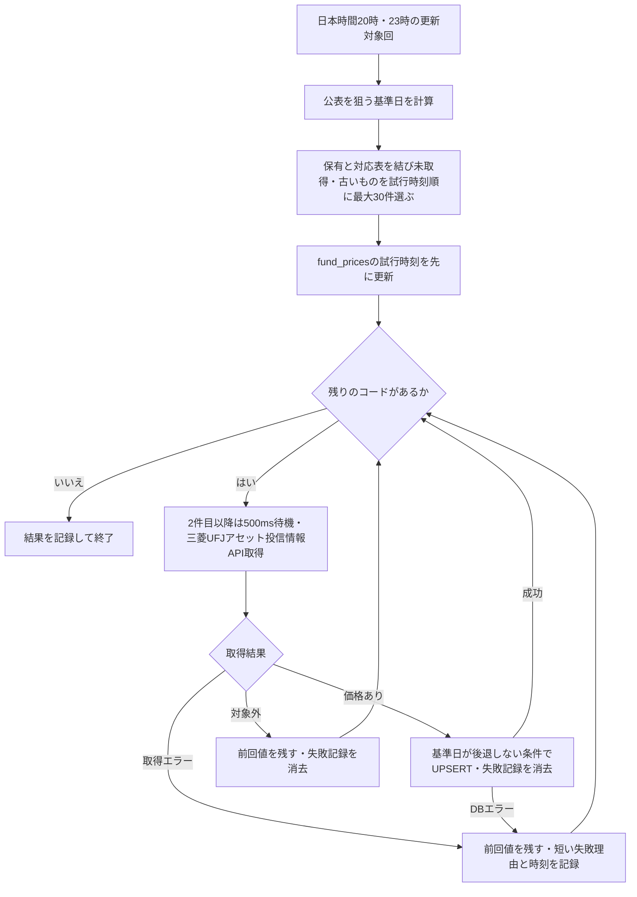
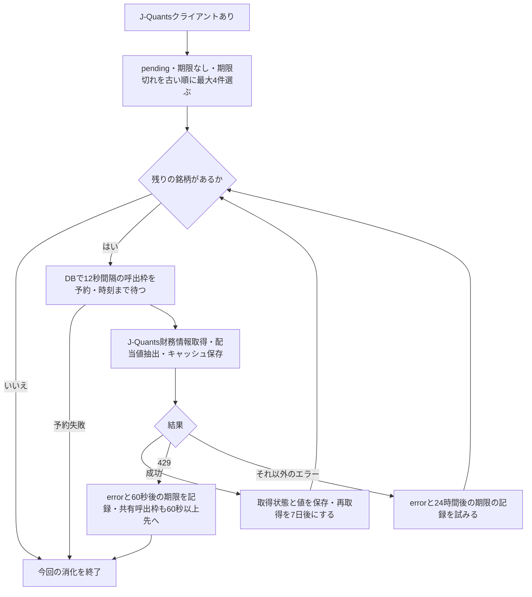
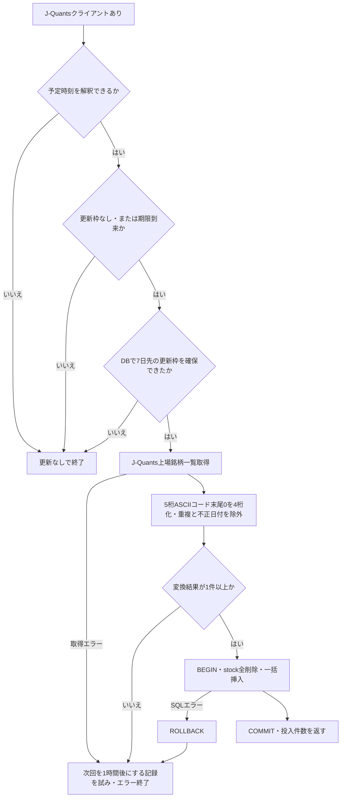

# バックエンドの処理分岐

アクティビティ図は、処理の順序・条件・繰り返しを示す図。本資料では Mermaid の `flowchart` で表す。APIの呼出順序は [シーケンス](21-backend-sequences.md) を参照する。
トランザクションは複数のDB操作をまとめて確定または取り消す単位、ロックは同じ対象の更新を順番に処理するための仕組み。

## CSV検証と保有データの置換

この図で分かること: 保有銘柄CSVではプレビューにエラーを返せても、確定取込はエラー行や有効行0件を拒否すること。

根拠:

- `backend/src/handlers/v1/csv_import.rs:12`・`backend/src/handlers/v1/csv_import.rs:34`・`backend/src/handlers/v1/csv_import.rs:52`（ファイル・プレビュー・確定）。
- `backend/src/services/csv/pipeline.rs:31`、`backend/src/services/csv/import.rs:62`（パースと保存前検証）。
- `backend/src/services/asset_balance.rs:44`・`backend/src/services/asset_balance.rs:76`（口座と行の判定・拒否）、`backend/src/services/asset_balance.rs:156`（個人のCSV価格列へ保存）。

ファイルはmultipartの `file` 項目で、ファイル名が `.csv` で終わることを確認する。プレビューでも認証時のDB読取はあるが、CSVの保存はない。

この図で分かること: 保存前の検証を通った行で、本人のデータだけを同一トランザクションで置き換えること。履歴更新はその後の別操作になる。

根拠:

- `backend/src/services/asset_balance.rs:156`（置換処理の呼出し）。
- `backend/src/services/domain/bulk.rs:117`・`backend/src/services/domain/bulk.rs:151`・`backend/src/services/domain/bulk.rs:162`・`backend/src/services/domain/bulk.rs:195`、`backend/src/services/domain.rs:18`（上限・ロック・本人の行の置換）。
- `backend/src/db.rs:755`・`backend/src/db.rs:779`（確定・未確定時の取り消し）、`backend/src/services/csv.rs:11`（別操作の履歴更新）。
- `backend/src/handlers/v1/csv_import.rs:59`（取込の後で履歴更新）。

矢印は主要な分岐を示す。BEGIN・ロック等のDBエラーも処理を中断する。CSV取込は共有の `security_prices` を更新しない。
投資信託保有CSVもエラー行・有効行0件を拒否して全置換する（`backend/src/services/fund_balance.rs:29`・`backend/src/services/fund_balance.rs:60`）。配当・国内株式取引・投資信託取引は追記型で、有効行の保存と重複スキップを行う（`backend/src/services/dividend.rs:27`・`backend/src/services/dividend.rs:154`、`backend/src/services/domestic_stock.rs:27`・`backend/src/services/domestic_stock.rs:239`、`backend/src/services/mutualfund.rs:26`・`backend/src/services/mutualfund.rs:164`）。

## 定期処理の入口

cron は定期実行の時刻指定。scheduled は Worker が定期実行イベントを受け取る入口。

この図で分かること: 毎分届く同じ入口で4処理を順番に評価すること。各処理のエラーを記録しても後続の処理へ進む。

根拠:

- `backend/wrangler.toml:45`（毎分の設定）、`backend/src/worker_entry.rs:199`（順序とエラー処理）、`backend/src/worker_entry.rs:285`・`backend/src/worker_entry.rs:294`（クライアントなしなら省略）。
- `backend/src/services/stock_price.rs:340`、`backend/src/services/fund_price.rs:437`（時刻条件）。

株価は予定時刻の分が5の倍数、投信は日本時間20時・23時の0分が対象回。配当とマスタはJ-Quantsクライアントがなければ省略する。全処理で対象がなくエラーもなければ、何もしなかったことを `noop` のログで示す。

## 株価更新

基準日は価格がどの日の確定値かを表す日付。UPSERT は行がなければ追加し、あれば更新するDB操作。

この図で分かること: 未更新の保有銘柄を最大15件選び、1銘柄の失敗で残りを止めず、以前の確定値を守る流れ。

根拠:

- `backend/src/services/stock_price.rs:21`・`backend/src/services/stock_price.rs:24`（上限と間隔）、`backend/src/services/stock_price.rs:184`（基準日のガード）、`backend/src/services/stock_price.rs:219`・`backend/src/services/stock_price.rs:230`（日付計算）。
- `backend/src/services/stock_price.rs:244`（対象選定・試行時刻・取得・継続）、`backend/src/services/stock_price.rs:81`（確定価格の解析）。

日本時間16時より前と土日は直前の平日を基準日上限とする。日付計算は祝日を扱わない。対象選定や試行時刻のDB更新自体が失敗した場合は、その回の株価処理をエラーで終了する。

## 投資信託基準価額更新

基準価額は投資信託の価格。協会コードは対応表 `fund_codes` が持つファンドの識別用コード。

この図で分かること: 保有ファンドと対応表から最大30件を選び、失敗理由を共有価格に記録しながら残りを続けること。

根拠:

- `backend/src/services/fund_price.rs:18`・`backend/src/services/fund_price.rs:21`（上限と間隔）、`backend/src/services/fund_price.rs:87`（値の検証）、`backend/src/services/fund_price.rs:201`（基準日のガード）。
- `backend/src/services/fund_price.rs:234`・`backend/src/services/fund_price.rs:258`（失敗記録）、`backend/src/services/fund_price.rs:312`（公表基準日）、`backend/src/services/fund_price.rs:329`（選定と結果別の処理）、`backend/src/services/fund_price.rs:437`（実行時刻）。

価格取得に成功しても基準日が古くUPSERTが0件なら、失敗記録だけを消す。対象外は取得失敗として記録しない。失敗理由の記録・消去が失敗しても残りを続ける。対象選定や試行時刻の更新が失敗すれば、その回の投信価格処理をエラーで終了する。

## 配当キャッシュの消化

キャッシュは外部から取得した値を再利用する保存先。`pending` は未取得で待機中、`stale_at` は再取得対象になる時刻。レート制御は上流APIへの呼び出し間隔をDBで共有する仕組み。

この図で分かること: 待機中・期限切れから最大4件を選び、DBの予約時刻を待って取得すること。429（呼び出し過多）とそれ以外の失敗では再試行間隔と継続条件が異なる。

根拠:

- `backend/src/services/dividend_cache.rs:19`・`backend/src/services/dividend_cache.rs:25`・`backend/src/services/dividend_cache.rs:29`（件数と間隔）、`backend/src/services/dividend_cache.rs:113`（選定・中断・継続）、`backend/src/services/dividend_cache.rs:207`（呼出枠）、`backend/src/services/dividend_cache.rs:248`（429時の延期）。
- `backend/src/services/dividend_cache/persistence.rs:10`（取得・7日の保存）、`backend/src/services/dividend_cache/persistence.rs:54`（エラー状態と期限）。
- `backend/src/worker_entry.rs:294`（クライアントなしなら呼ばない）。

API側はキャッシュを読み、未取得行を `pending` として追加するだけで外部APIを呼ばない。既存行は再投入で上書きせず、期限に従って定期処理の対象になる（`backend/src/services/dividend_cache.rs:39`・`backend/src/services/dividend_cache.rs:63`）。
エラー記録や共有枠の延期がDBエラーになる場合もあるため、図の60秒・24時間は記録が成功した場合の再試行間隔。既存行のエラー記録では以前の配当値を消さず、状態と期限等を更新する。

## 銘柄マスタ更新

マスタは銘柄検索の基礎になる共有の一覧。更新枠は次に更新してよい時刻を保存したDB行で、同じ回の重複実行を防ぐ判定にも使う。

この図で分かること: 毎分のイベントでもマスタ更新は7日の枠で制御し、取得結果が空なら既存一覧を消さないこと。

根拠:

- `backend/src/services/stock_master.rs:27`（変換）、`backend/src/services/stock_master.rs:50`（トランザクション）、`backend/src/services/stock_master.rs:114`（期限判定）、`backend/src/services/stock_master.rs:131`（枠取得）。
- `backend/src/services/stock_master.rs:150`（失敗時の延期）、`backend/src/services/stock_master.rs:171`（呼出順序と0件の拒否）。
- `backend/src/worker_entry.rs:285`（クライアント有無）。

更新枠がない初回も同じ経路で実行する。判定は `stock.date` やテーブルの件数ではなく更新枠の時刻を使う。枠を取る前のDBエラーはそのまま返し、取得・変換・置換で失敗したときに1時間後への延期を試みる。置換対象は `stock` だけで、共有価格・配当キャッシュは削除しない。

## 未確認

- デプロイ済み環境でのcron配送状況・各外部APIの実応答・実行所要時間は確認していない。
- 市場の祝日や臨時休場を完全に扱うカレンダーは確認していない。図はコードで計算している曜日・時刻までを示す。

## 文書との食い違い

- [db-design.md](../db-design.md) は株式の保有と共有価格を中心に説明しており、表一覧には現行の `fund_balances`・`fund_codes`・`fund_prices`・`csv_import_history` が載っていない。本資料はそれらを使うコードの流れを示すが、同文書やER図は更新しない（`backend/src/services/fund_price.rs:333`、`backend/src/services/csv.rs:21`）。
