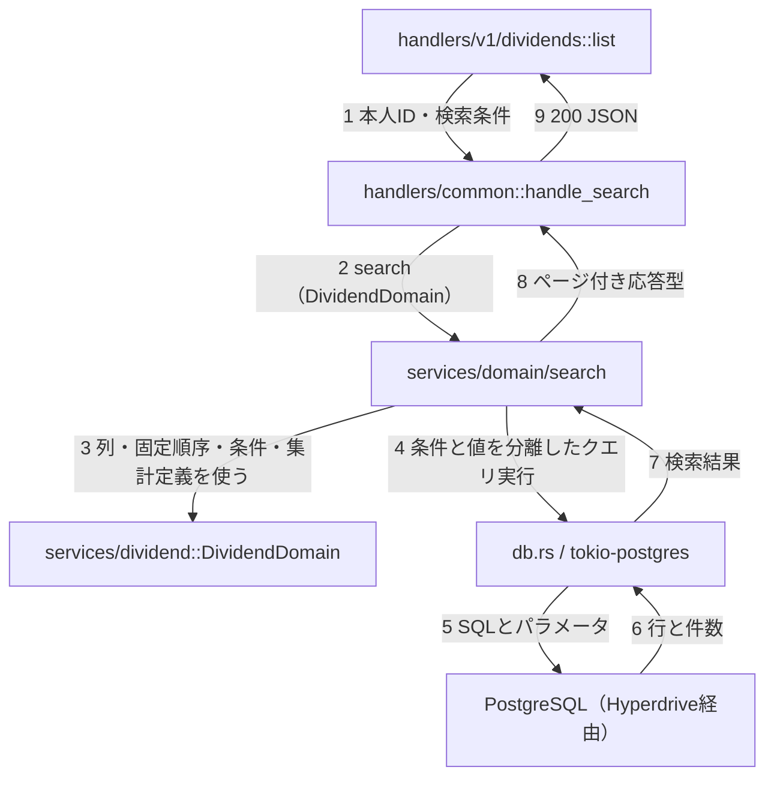
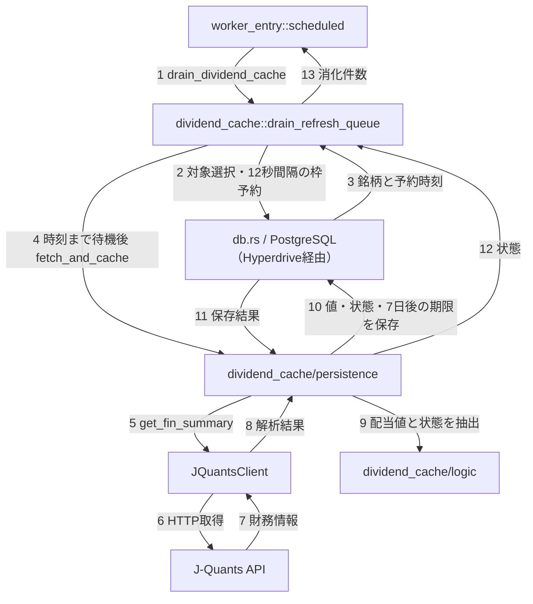

# バックエンド部品間のやりとり

コミュニケーション図は、部品同士が何をやりとりするかを番号付きの矢印で示す図。Mermaidには専用記法がないため `flowchart` を使う。番号は各図の中での順序であり、図をまたいだ通し番号ではない。
handler はHTTPの入出力、service は業務処理とSQL、db はクエリ実行を担当する。時系列の分岐は [シーケンス](21-backend-sequences.md)、繰り返しと失敗時の扱いは [アクティビティ](22-backend-activity.md) を参照する。

## handler → service → db

この図で分かること: 認証後の配当一覧が共通検索処理へ本人のIDを渡し、DB結果をレスポンスへまとめて返す関係。件数・一覧・任意の集計は並行するため、DBとのやりとりは一つにまとめる。

根拠:

- `backend/src/handlers/v1/dividends.rs:47`、`backend/src/handlers/common.rs:17`（本人IDと検索条件の受渡し）。
- `backend/src/services/domain/search.rs:19`・`backend/src/services/domain/search.rs:157`、`backend/src/services/dividend.rs:61`（ドメイン定義を使う共通検索）。
- `backend/src/db.rs:154`・`backend/src/db.rs:211`・`backend/src/db.rs:454`・`backend/src/db.rs:472`（クエリからDBまで）、`backend/src/services/domain/search.rs:185`（結果の合流）。

SQLパラメータは検索値をSQLの構造と分けて渡す値。図の「定義を使う」は別サービスへの通信ではなく、同じRustプログラム内の型・関数の利用である。

## cron → 外部API → db

cron は定期実行の時刻指定で、ここでは `scheduled` 入口から呼ぶ。呼出枠はAPI利用間隔を守るためにDBに保存する予約時刻、キャッシュは取得値の再利用先。

この図で分かること: 配当キャッシュの定期消化が、DBで対象と呼出枠を決めてから外部APIを呼び、結果をDBへ戻す関係。成功する1銘柄を示す。

根拠:

- `backend/src/worker_entry.rs:210`・`backend/src/worker_entry.rs:294`（定期消化の呼出し）。
- `backend/src/services/dividend_cache.rs:113`・`backend/src/services/dividend_cache.rs:207`（対象選定・枠予約・待機）。
- `backend/src/services/dividend_cache/persistence.rs:10`（取得・抽出・保存）、`backend/src/services/dividend_cache/logic.rs:20`（配当値と状態の判定）。
- `backend/src/services/jquants/client_worker.rs:9`（財務情報取得の入口）、`backend/src/services/jquants/client_worker.rs:51`（HTTP取得）。

枠を保存する表は `market_data_provider_rate_control`、配当値を保存する表は `dividend_per_share_cache`。HTTPリクエスト時のキャッシュ読取・予約追加とは別の処理であり、API応答を待たせて連続取得する構成ではない。

## 未確認

- 外部サービス側の内部処理・配信基盤の内部経路は追跡していない。
- 番号はコードの呼出順序を表す。通信遅延や並行した別Workerの実行順は測定していない。

## 文書との食い違い

- 移行メモの過去構成と現行コードの扱いは [層構造とルート](20-backend-structure.md#文書との食い違い) に記載。本図で新たに追記すべき食い違いは確認していない。
