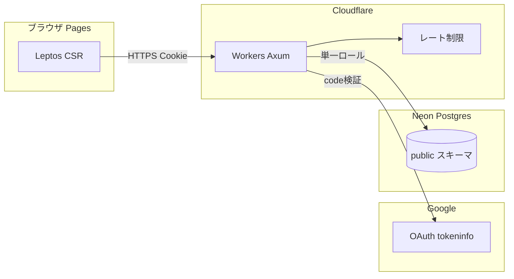
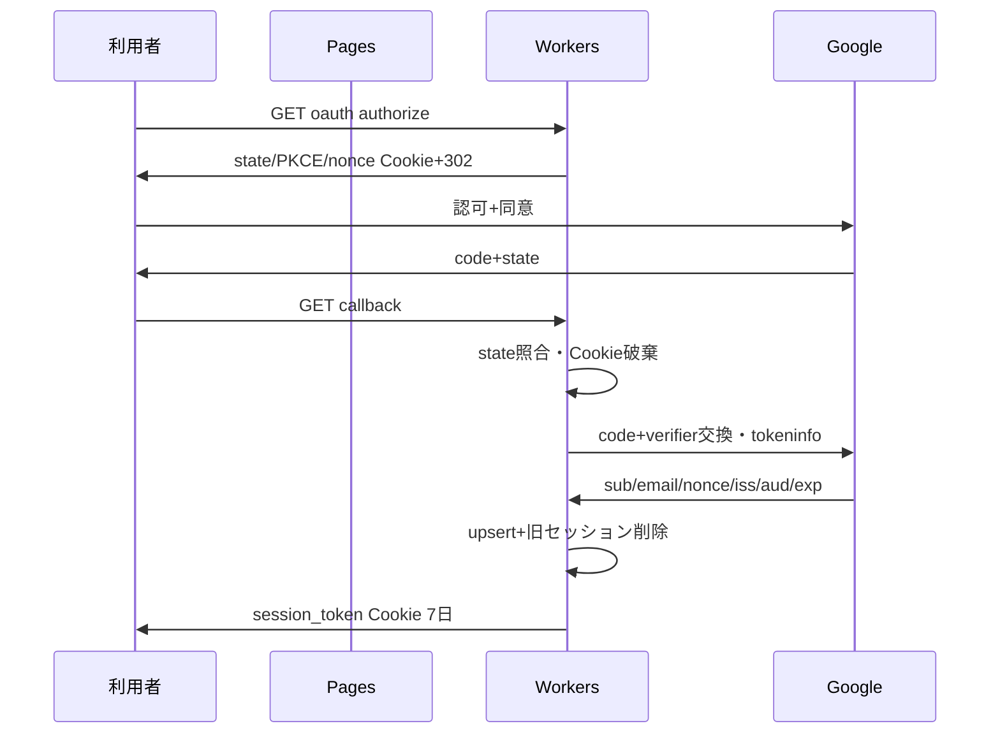

# 脅威モデル

## 守るもの

- 利用者の資産データ(保有数量・金額・銘柄・口座・取引日・配当)
- 識別子(users.email・google_id)と認証秘密(sessions.token_hash)
- 集計結果の正しさ(税・損益の再計算を含む)
- サービスの可用性(CSV 取込・cron・検索)

## 攻撃者

- ネットワーク上の第三者(セッション奪取・CSRF・なりすまし)
- 他の利用者(他人の user_id への水平アクセス)
- 悪意ある CSV・拡張機能・OAuth リダイレクトを触る者
- 依存・CI 経由の侵入者(サプライチェーン)
- DB に直接触れる者(管理者・漏洩した接続情報)は別境界とする

## 信頼の境界

境界: (1)ブラウザ-Wokers 間は Cookie+Origin、(2)Workers-Google 間は tokeninfo 信頼、(3)Workers-DB 間は単一ロール+アプリ層 WHERE user_id(本点検の残件 7-1)。

## ログインの流れ

