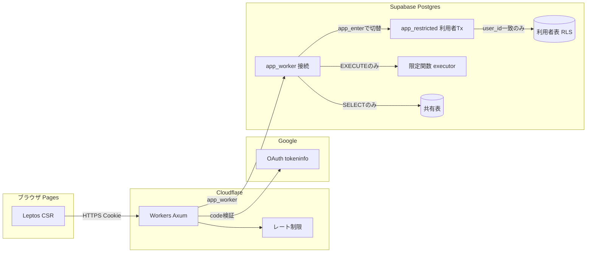
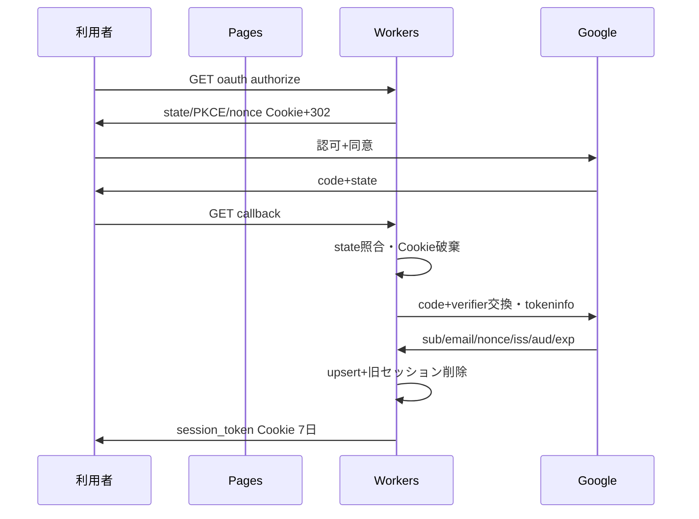

# 脅威モデル

## 守るもの

- 利用者の資産データ(保有数量・金額・銘柄・口座・取引日・配当)
- 識別子(users.email・google_id)と認証秘密(sessions.token_hash)
- 集計結果の正しさ(税・損益の再計算を含む)
- サービスの可用性(CSV 取込・cron・検索)

## 攻撃者

- ネットワーク上の第三者(セッション奪取・CSRF・なりすまし)
- 他の利用者(他人の user_id への水平アクセス)
- 悪意ある CSV・拡張機能・OAuth リダイレクトを触る者
- 依存・CI 経由の侵入者(サプライチェーン)
- DB に直接触れる者(管理者・漏洩した接続情報)は別境界とする

## 信頼の境界

境界: (1)ブラウザ-Workers 間は Cookie+Origin、(2)Workers-Google 間は tokeninfo 信頼、(3)Workers-DB 間は app_worker(NOBYPASSRLS・表の所有者ロールに所属しない)で接続し、利用者の要求では Tx 内で app_enter により app_restricted に切り替えて RLS(user_id = app.current_user_id)を効かせる。共有表は SELECT のみ、利用者 ID が定まる前の認証・利用者をまたぐ処理・共有表の書き込みは引数と戻りを絞った限定関数(executor ロールの SECURITY DEFINER)に閉じ込め EXECUTE のみを与える。FORCE ROW LEVEL SECURITY は付けない(docs/security/db-rls-plan.md §28)。本番の接続確認は #2017(11/18 の cron の DB access ログ)。構成の正本は docs/security/db-rls-plan.md §25・§28、backend/migrations/README.md「ビューと新しい表の RLS の決まり」。

## ログインの流れ

